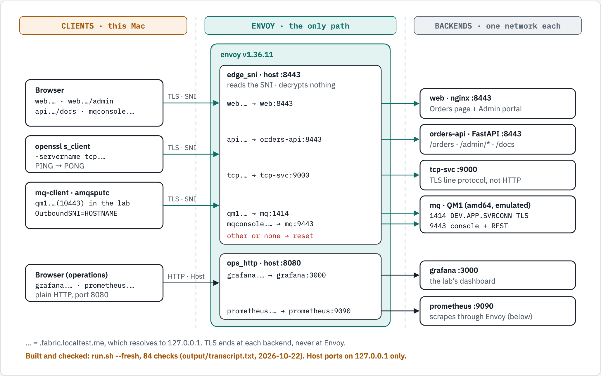
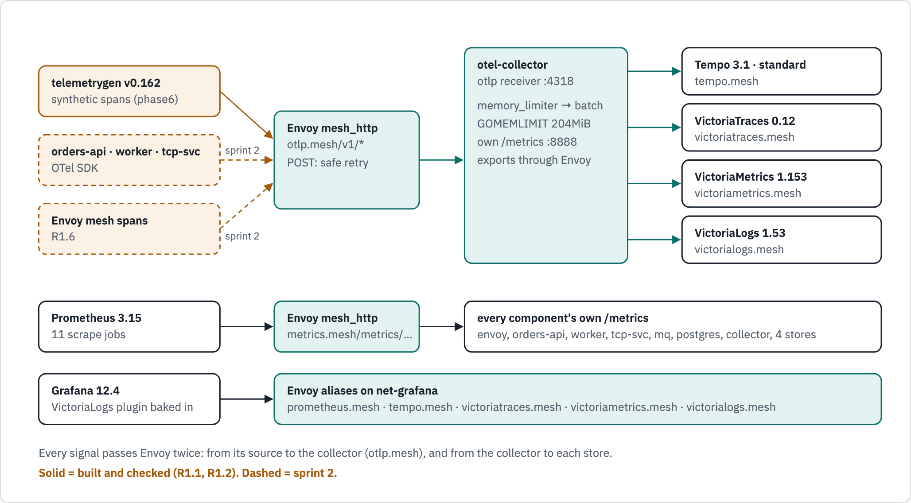

# Demo 57 — One TLS port for every service, with Envoy as the only path

A Docker Compose lab, run with Podman, in which Envoy is the only route between any two
components. One TLS port, 8443, carries a web front end with an admin portal, a REST API with
Swagger, a raw TCP service, IBM MQ and its web console, each chosen by the hostname the client
sends (SNI); Envoy never decrypts. Inside the lab, Envoy also carries every call between
services, with retries, and every metrics scrape. It is the generic, runnable form of the
shared-SNI design for exposing IBM MQ through Envoy.

## What you get

- One port for five tenants: `web`, `api`, `tcp`, `qm1` and `mqconsole` under
  `*.fabric.localtest.me:8443`. A connection with an unknown or missing SNI is reset.
- Envoy as the only path, enforced: each component has its own internal network shared with
  Envoy alone; `orders-api` cannot resolve `postgres`, and no component can reach the internet.
- A native IBM MQ client that puts and gets through the shared port with
  `OutboundSNI=HOSTNAME` and a client certificate; MQ's default channel-name SNI and a client
  with no certificate are both refused.
- An order saved in Postgres, announced on MQ and marked processed by the worker in 1 s.
- Retries that rescue what they safely can: under 50% injected failures all 10 orders were
  processed, after 9 Envoy retries.
- Recovery without a restart by hand: from a Postgres restart, from MQ stopped and started,
  and from the TCP service stopped and started.
- Metrics from all six components scraped through Envoy, on a Grafana dashboard of 14 charts.

## Architecture

```text
browser, openssl, MQ client                 grafana.*, prometheus.* (browser)
        │ TLS, SNI = <name>.fabric.localtest.me    │ HTTP, Host header
        ▼ 127.0.0.1:8443                           ▼ 127.0.0.1:8080
┌──────────────────────────── Envoy v1.36.11 ────────────────────────────┐
│ edge_sni :10443  reads the SNI, passes TLS through, resets the rest    │
│ ops_http :10080  Grafana and Prometheus                                │
│ mesh_http :18080 east-west HTTP, retries, /metrics/<component>         │
│ mesh_pg  :15432  Postgres, 3 connect attempts                          │
│ stats    :9902   /stats/prometheus only                                │
└──┬───────┬────────┬────────┬────────┬────────┬────────┬────────┬───────┘
   web  orders-api tcp-svc  mq (QM1)  worker  postgres prometheus grafana
   otel-collector  tempo  victoria-traces  victoria-metrics  victoria-logs  (Release 1)
        (each on its own internal network, shared with Envoy only)
```

The same, layer by layer (source: `docs/diagrams/layers/source.html`, drawn with diagram-kit):


*Every arrow between layers is a hop through Envoy. Dashed: auto-instrumentation, sprint 2.*



*Into the lab: one TLS port, routed on the hostname each client sends. Envoy decrypts nothing.*


*Between components: numbered in the order an order flows. Retries happen only where they are
safe.*



*Release 1's telemetry: every signal passes Envoy twice, into the collector and out to each
store. Dashed: the services' own telemetry, sprint 2.*

## What it looks like

Captured on the lab rebuilt on 2026-10-22 by `tests/browser_flows.py` and
`tests/grafana_capture.py` (each step must show its expected text, or the capture fails).


*The Orders page after placing an order and pinging the TCP service. Order #121 still reads
`created`: the picture is taken as the API answers, before the worker has processed it.*


*The admin portal, opened with the lab token `fabric-admin`: every component up, each tenant's
connections, Envoy's retries per cluster, and order #121 now `processed`. A wrong token is
refused (`docs/screenshots/admin-wrong-token-refused.light.png`).*


*Swagger UI at `https://api.fabric.localtest.me:8443/docs`. The status update the worker makes
is not here: it is served on the internal port only.*


*The dashboard over 15 minutes, the last two of them under `scripts/load.py --seconds 120`. The
retry panels are flat: nothing failed. Step 7 below makes them move.*

| Name | Address | What it is | Who answers |
|---|---|---|---|
| `web.fabric.localtest.me` | `127.0.0.1:8443` | Orders page and admin portal | nginx, TLS ends there |
| `api.fabric.localtest.me` | `127.0.0.1:8443` | REST API, Swagger at `/docs` | orders-api, TLS ends there |
| `tcp.fabric.localtest.me` | `127.0.0.1:8443` | Line protocol: `PING`, `TIME`, `ECHO` | tcp-svc, TLS ends there |
| `qm1.fabric.localtest.me` | `127.0.0.1:8443` | MQ channel `DEV.APP.SVRCONN`, mutual TLS | queue manager `QM1` |
| `mqconsole.fabric.localtest.me` | `127.0.0.1:8443` | MQ web console | MQ web server |
| `grafana.fabric.localtest.me` | `127.0.0.1:8080` | Dashboard | Grafana |
| `prometheus.fabric.localtest.me` | `127.0.0.1:8080` | Metrics | Prometheus |

## Prerequisites

- Podman 5 with a running machine of 4 GiB, and a Compose provider (`podman compose`).
  Rootless Podman binds no host port below 1024, so the lab uses 8443 and 8080.
- OpenSSL 3 or later (`brew install openssl`); macOS's own LibreSSL is refused.
- Python 3, `curl` and `uuidgen`.
- Internet access for the image pulls. `*.localtest.me` resolves to `127.0.0.1` in public DNS,
  so no hosts file is needed.
- On Apple silicon, amd64 emulation in the Podman machine: the IBM MQ image has no arm64
  build. Check it with:

```bash
podman run --rm --platform linux/amd64 docker.io/library/alpine:3.20 uname -m
```

## Steps

Run everything from `demos/57-sni-fabric-lab/`:

### 1. Create the CA and the certificates

Each component gets `tls.crt`, `tls.key` and `ca.crt`, the layout a cert-manager Secret uses.

```bash
scripts/gen-certs.sh
```

Result: `web`, `orders-api`, `tcp-svc`, `mq` and `mq-client` each with `CHAIN ok`, expiring
`Nov 22 2027`.

### 2. Write the lab credentials

```bash
scripts/gen-secrets.sh
```

Result: `secrets/` holds `admin-token`, `postgres-password`, `mq-admin-password`,
`mq-app-password` and `grafana-admin-password`, with the lab values listed under Reference.

### 3. Start the lab

```bash
podman compose up -d --build
```

Result: every health check passes; Envoy after 6 s, Postgres after 13 s, MQ and Grafana after
124 s.

### 4. Check the shared port and the services

```bash
scripts/verify.sh
```

Result: phases 1 to 3, 57 checks, `failures: 0`.

### 5. Put and get with the native MQ client

```bash
podman compose run --rm mq-client hostname
```

Result: `RESULT ok: both messages put and got back through Envoy with OutboundSNI=HOSTNAME`.

### 6. Send traffic

```bash
python3 scripts/load.py --seconds 120
```

Result: 240 new orders `201`, 240 replays `200`, 240 pings `200`, 24 unknown-SNI connections
reset.

### 7. Break things and watch them recover

```bash
scripts/verify.sh phase5
```

Result: 7 checks, `failures: 0`; under 50% chaos `processed=10 of 10 after 3s`, and the order
taken while MQ was down `processed=1 of 1 after 15s` once the sweeper re-sent it.

## Verify

Rebuild from nothing and run every check, recorded to `output/transcript.txt`:

```bash
scripts/run.sh --fresh
```

Result: 7 min 52 s; 84 checks pass, `31 queries, 0 with errors or warnings`, and
`PASS  14 charts in 7 sections; both forms agree on colours, styles, units, legends`.

Then open <https://web.fabric.localtest.me:8443/admin> with the token `fabric-admin`, and
<http://grafana.fabric.localtest.me:8080/d/sni-fabric-lab/sni-fabric-lab>.

## Reference

| Listener | Port (host) | Routes on | Retries |
|---|---|---|---|
| `edge_sni` | 10443 (8443) | SNI | 3 connect attempts |
| `mesh_http` | 18080 | `Host` and path | `PUT`: 5xx, reset, connect failure, 3 times; `POST` and MQ's destructive `DELETE`: only if the request never left |
| `mesh_pg` | 15432 | port | 3 connect attempts |
| `ops_http` | 10080 (8080) | `Host` | none |
| `stats` | 9902 | path | none |

| Login | User | Lab value |
|---|---|---|
| Admin portal and `/admin/*` | | `fabric-admin` |
| MQ console | `admin` | `fabric-mq-admin` |
| MQ REST API and clients | `app` | `fabric-mq-app` |
| Grafana | `admin` | `fabric-grafana` |
| Postgres | `fabric` | `fabric-postgres` |

The values are public: use them for this lab only. Every script and option:
`docs/usage.md`. Certificates on Kubernetes: `docs/kubernetes-certs.md`. The dashboard's
choices: `docs/metrics/dashboard-choices.md`.

## Troubleshooting

- An order stays `created` for about a minute after Envoy or the worker restarted → a waiting
  MQ REST get that lost its caller still took the event (the get is destructive and not
  transactional) → nothing to do: the sweeper re-sends it; measured, order 600 was processed
  75 s after it was created.
- The MQ console says "The data cannot be displayed" → its web server starts about two minutes
  after the queue manager, and phase 5 stops MQ on purpose → wait for `mq` to be healthy, then
  reload and log in again.
- Grafana shows an old dashboard after `build_dashboard.py` → Grafana 12.4.12 did not reload
  the file while running → restart Grafana.

## Clean up

```bash
podman compose down -v
```

## What's next

- The roadmap for growing this lab into "Fabric Coffee", observability first: `docs/roadmap/ROADMAP.md`,
  with Release 1's stories in `docs/roadmap/BACKLOG.md` and the story so far in `docs/story/`.
- Move the lab to Kubernetes with cert-manager: `docs/kubernetes-certs.md`.
- Replace the static listeners with Envoy Gateway once the cluster's Gateway API CRDs include
  `TLSRoute` (OpenShift 4.22 ships the v1.4.1 standard bundle, which does not).
- Put a load balancer with a TCP-only virtual server in front of port 8443.
- Load the Perses form of the dashboard (`observability/perses/fabric.json`) in the OpenShift
  console.
