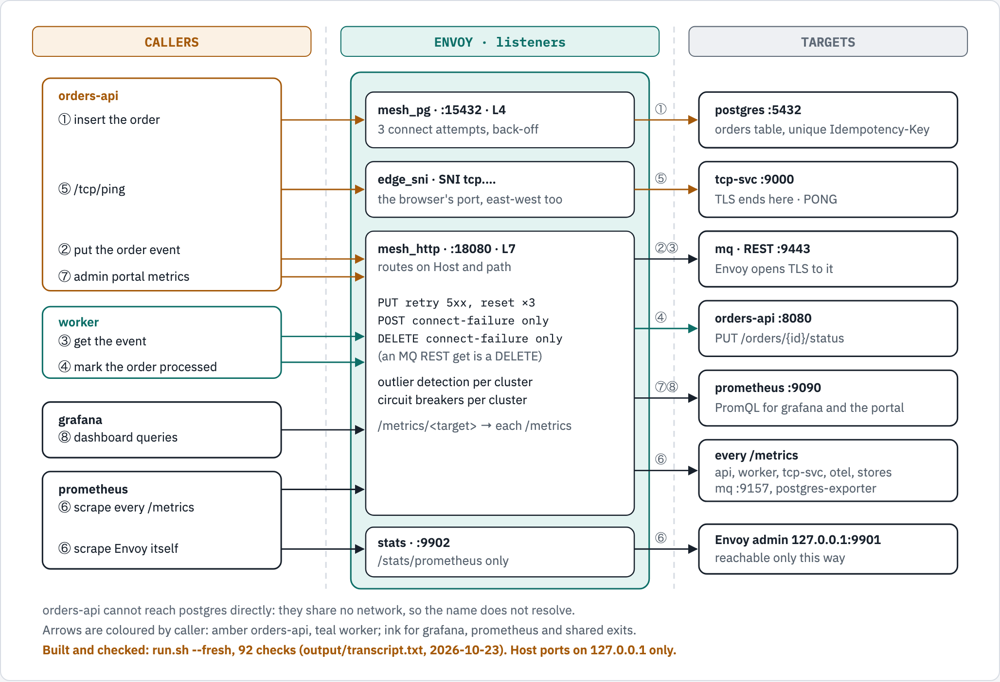
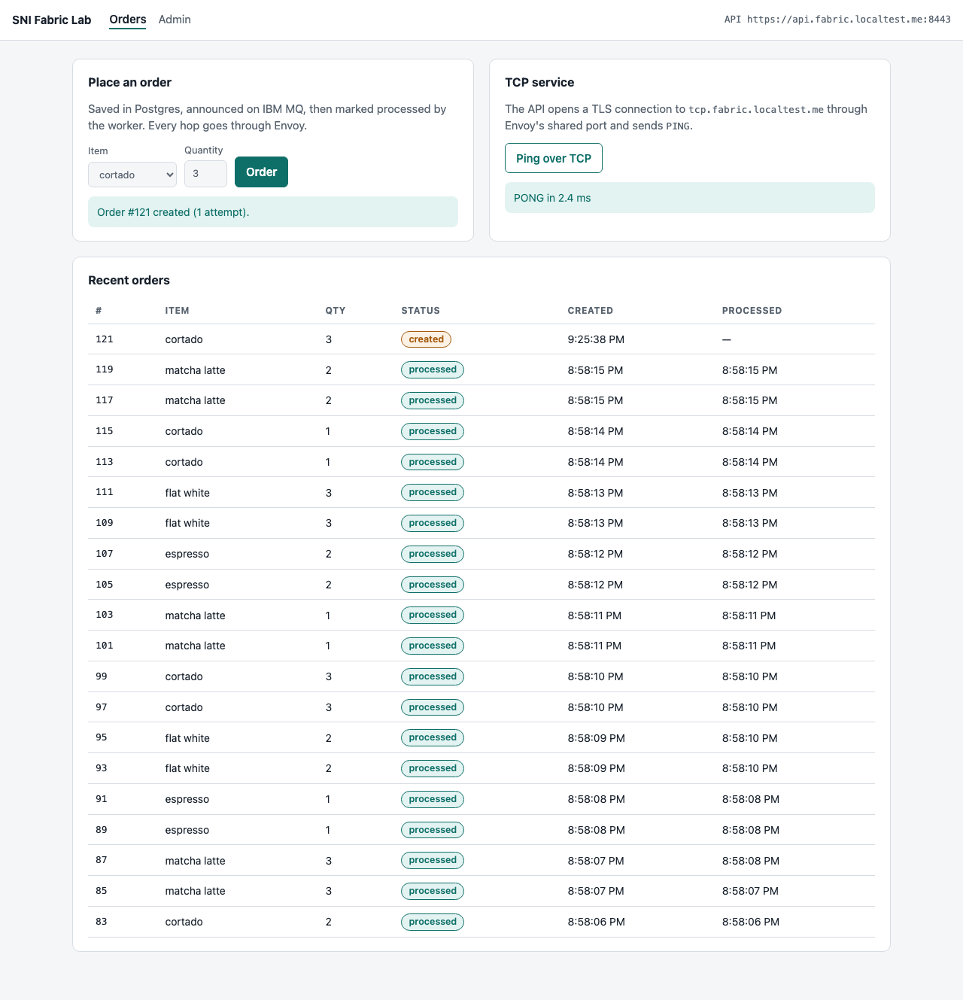
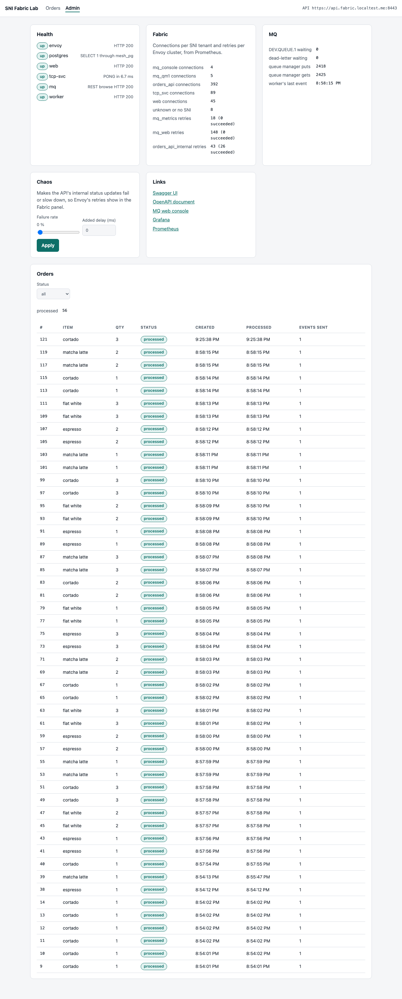
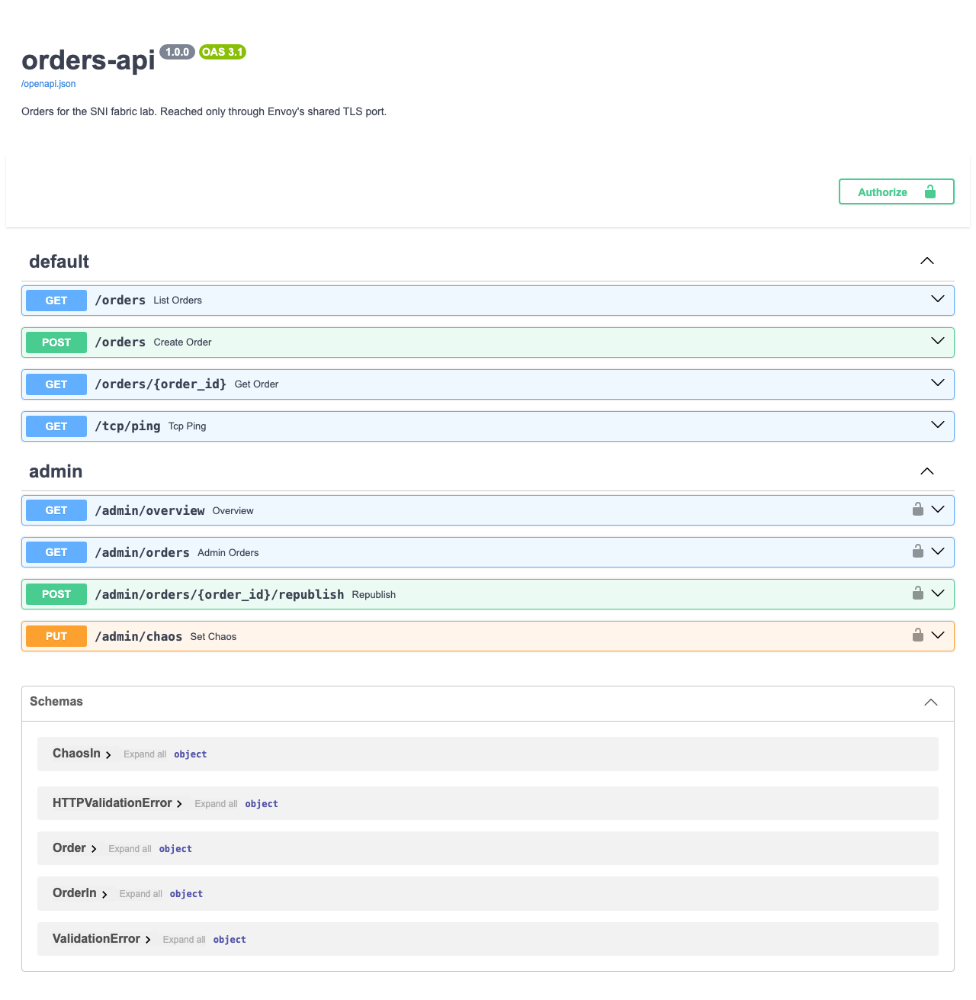
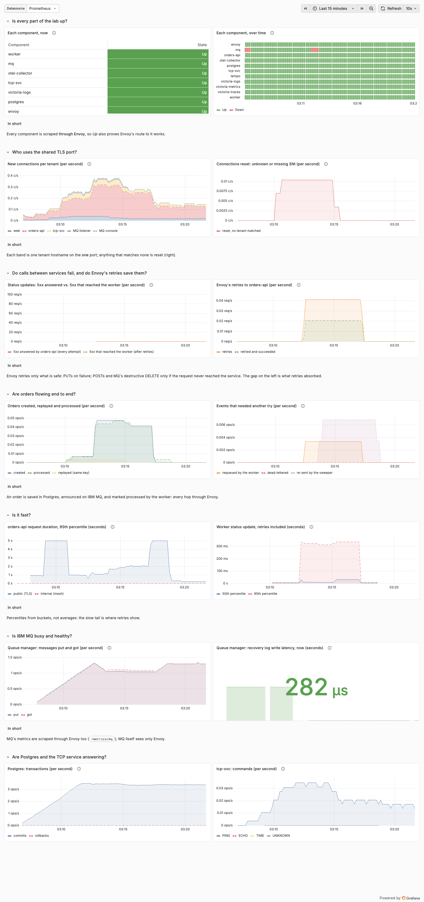

# Demo 57 — One TLS port for every service, with Envoy as the only path

A Docker Compose lab, run with Podman, in which Envoy is the only route between any two
components. One TLS port, 8443, carries a web front end with an admin portal, a REST API with
Swagger, a raw TCP service, IBM MQ and its web console, each chosen by the hostname the client
sends (SNI); Envoy never decrypts. Inside the lab, Envoy also carries every call between
services, with retries, and every metrics scrape. It is the generic, runnable form of the
shared-SNI design for exposing IBM MQ through Envoy.

## What you get

- One port for five tenants: `web`, `api`, `tcp`, `qm1` and `mqconsole` under
  `*.fabric.localtest.me:8443`. A connection with an unknown or missing SNI is reset.
- Envoy as the only path, enforced: each component has its own internal network shared with
  Envoy alone; `orders-api` cannot resolve `postgres`, and no component can reach the internet.
- A native IBM MQ client that puts and gets through the shared port with
  `OutboundSNI=HOSTNAME` and a client certificate; MQ's default channel-name SNI and a client
  with no certificate are both refused.
- An order saved in Postgres, announced on MQ and marked processed by the worker in 1 s.
- Retries that rescue what they safely can: under 50% injected failures all 10 orders were
  processed, after 5 Envoy retries.
- Recovery without a restart by hand: from a Postgres restart, from MQ stopped and started,
  and from the TCP service stopped and started.
- Metrics from every component scraped through Envoy (11 scrape jobs), on a Grafana dashboard
  of 14 charts. Prometheus is the one scraper and copies every sample to VictoriaMetrics by
  remote write ([why and how](docs/remote-write.md)); ten dashboard queries agree in both stores, and the dashboard opens on either.
- Release 1 so far: an OpenTelemetry Collector and four telemetry stores (Tempo,
  VictoriaTraces, VictoriaMetrics, VictoriaLogs), also reached only through Envoy. The story so
  far, with screenshots: `docs/story/01-turn-the-lights-on.md`.
- Traces with no tracing code: orders-api, the worker and tcp-svc start under
  `opentelemetry-instrument`, and one order is a trace of 12 spans in Tempo and VictoriaTraces
  ([how it works](docs/tracing.md)).

## Words used here

| Word | What it means in this lab |
|---|---|
| TLS | The encryption behind `https://`. Each service has its own certificate and key. |
| SNI | The hostname a client names at the very start of a TLS connection, before anything is encrypted. Envoy reads it to choose the backend. |
| TLS pass-through | Envoy forwards the encrypted bytes untouched; only the backend can decrypt them. |
| Mutual TLS | Both sides show a certificate: the MQ client proves who it is, as the server does. |
| Envoy listener | One port Envoy listens on, with its own routing rules (`edge_sni`, `mesh_http`, ...). |
| Internal network | A Podman network with no route out. Each component sits on its own, shared only with Envoy. |
| Alias (`api.mesh`) | A name Envoy answers to on a network; the only names a component can look up. |
| Retry | Envoy trying a request again. It does so only where repeating it cannot do harm twice. |
| Sweeper | A loop in orders-api that re-sends the MQ event of any order still `created` after 60 s. |
| Destructive get | Reading a message from MQ's REST API removes it from the queue; repeating the read would lose a different message, so Envoy never retries it once sent. |
| Span, trace | A span is one timed operation (a request served, an HTTP call, an SQL statement); a trace is the spans of one piece of work, linked by a shared trace id. |
| `opentelemetry-instrument` | The command each service starts under: it reads the `OTEL_*` variables, sets up the exporter and loads the instrumentations installed in that image (FastAPI, httpx and psycopg in orders-api; httpx in the worker; none in tcp-svc) before the service's own code runs. |

## Architecture

```text
browser, openssl, MQ client                 grafana.*, prometheus.*, victoriametrics.*
        │ TLS, SNI = <name>.fabric.localtest.me    │ HTTP, Host header
        ▼ 127.0.0.1:8443                           ▼ 127.0.0.1:8080
┌──────────────────────────── Envoy v1.36.11 ────────────────────────────┐
│ edge_sni :10443  reads the SNI, passes TLS through, resets the rest    │
│ ops_http :10080  Grafana, Prometheus; VictoriaMetrics: the whole app   │
│                  from this Mac, the read API from a container          │
│ mesh_http :18080 east-west HTTP, retries, /metrics/<component>         │
│ mesh_pg  :15432  Postgres, 3 connect attempts                          │
│ stats    :9902   /stats/prometheus only                                │
└──┬───────┬────────┬────────┬────────┬────────┬────────┬────────┬───────┘
   web  orders-api tcp-svc  mq (QM1)  worker  postgres prometheus grafana
   otel-collector  tempo  victoria-traces  victoria-metrics  victoria-logs  (Release 1)
        (each on its own internal network, shared with Envoy only)
```

The same, layer by layer (source: `docs/diagrams/layers/source.html`, drawn with diagram-kit):


*Every arrow between layers is a hop through Envoy. Dashed: the rest of sprint 2 (R1.5–R1.8).*


*Into the lab: one TLS port, routed on the hostname each client sends. Envoy decrypts nothing.
On 8080, ops_http tells the Mac from a container by the connection's source: Podman's forwarder
connects from Envoy's own address (`10.89.18.3` to `10.89.18.3` when R1.10 was verified; the
addresses change when the lab is rebuilt) and gets VictoriaMetrics' whole app; a container
connects from its own (`10.89.17.2` to `10.89.17.3`) and gets the read API only. The route test
checks both: 12 checks from this Mac, 4 refusals from a container.*



*Between components: numbered in the order an order flows. Retries happen only where they are
safe.*


*Release 1's telemetry: every signal passes Envoy twice, into the collector and out to each
store. Dashed: the services' own telemetry, sprint 2.*

## What it looks like

Captured on the lab rebuilt on 2026-10-22 by `tests/browser_flows.py` and
`tests/grafana_capture.py` (each step must show its expected text, or the capture fails).



*The Orders page after placing an order and pinging the TCP service. Order #121 still reads
`created`: the picture is taken as the API answers, before the worker has processed it.*



*The admin portal, opened with the lab token `fabric-admin`: every component up, each tenant's
connections, Envoy's retries per cluster, and order #121 now `processed`. A wrong token is
refused (`docs/screenshots/admin-wrong-token-refused.light.png`).*



*Swagger UI at `https://api.fabric.localtest.me:8443/docs`. The status update the worker makes
is not here: it is served on the internal port only.*



*The dashboard over 15 minutes, the last two of them under `scripts/load.py --seconds 120`. The
retry panels are flat: nothing failed. Step 7 below makes them move.*

| Name | Address | What it is | Who answers |
|---|---|---|---|
| `web.fabric.localtest.me` | `127.0.0.1:8443` | Orders page and admin portal | nginx, TLS ends there |
| `api.fabric.localtest.me` | `127.0.0.1:8443` | REST API, Swagger at `/docs` | orders-api, TLS ends there |
| `tcp.fabric.localtest.me` | `127.0.0.1:8443` | Line protocol: `PING`, `TIME`, `ECHO` | tcp-svc, TLS ends there |
| `qm1.fabric.localtest.me` | `127.0.0.1:8443` | MQ channel `DEV.APP.SVRCONN`, mutual TLS | queue manager `QM1` |
| `mqconsole.fabric.localtest.me` | `127.0.0.1:8443` | MQ web console | MQ web server |
| `grafana.fabric.localtest.me` | `127.0.0.1:8080` | Dashboard | Grafana |
| `prometheus.fabric.localtest.me` | `127.0.0.1:8080` | Metrics | Prometheus |
| `victoriametrics.fabric.localtest.me` | `127.0.0.1:8080` | Metrics, vmui at `/vmui/`; the whole app from this Mac, the read API from a container | VictoriaMetrics |

## Prerequisites

Check each one before you start; the expected answer is beside it.

| Need | Check | Expect |
|---|---|---|
| Podman 5 or later | `podman --version` | `podman version 5.` or later (recorded on 6.1.2) |
| A running Podman machine with 4 GiB | `podman machine list` | `Currently running`, memory `4GiB` |
| A Compose provider | `podman compose version` | a version line, no error |
| OpenSSL 3 or later | `openssl version` | `OpenSSL 3.` or later, not `LibreSSL` |
| Python 3 | `python3 --version` | `Python 3.` something; the scripts need no extra packages |
| `curl`, `uuidgen` | `command -v curl uuidgen` | two paths |

- Rootless Podman binds no host port below 1024, so the lab uses 8443 and 8080.
- If `openssl version` says `LibreSSL` (macOS's own), install OpenSSL and put it first on your
  `PATH` for this shell, so the scripts and the exercises in GUIDE.md both use it:

```bash
brew install openssl
export PATH="$(brew --prefix openssl)/bin:${PATH}"
openssl version
```

- Internet access for the image pulls. `*.localtest.me` resolves to `127.0.0.1` in public DNS,
  so no hosts file is needed.
- On Apple silicon, amd64 emulation in the Podman machine: the IBM MQ image has no arm64
  build. Check it with:

```bash
podman run --rm --platform linux/amd64 docker.io/library/alpine:3.20 uname -m
```

## Steps

Run everything from `demos/57-sni-fabric-lab/`:

### 1. Create the CA and the certificates

Each component gets `tls.crt`, `tls.key` and `ca.crt`, the layout a cert-manager Secret uses.

```bash
scripts/gen-certs.sh
```

Result: `web`, `orders-api`, `tcp-svc`, `mq` and `mq-client` each with `CHAIN ok`, expiring
`Nov 22 2027`.

### 2. Write the lab credentials

```bash
scripts/gen-secrets.sh
```

Result: `secrets/` holds `admin-token`, `postgres-password`, `mq-admin-password`,
`mq-app-password`, `grafana-admin-password` and `worker-token`, with the lab values listed
under Reference. They are fixed, public lab values (`--random` writes random ones).

### 3. Start the lab

This builds the lab's images and starts every container. IBM MQ is slow to start under amd64
emulation; about two minutes is normal.

```bash
podman compose up -d --build
```

Result: every health check passes; Envoy after 0 s, Postgres after 6 s, MQ after 143 s and
Grafana after 143 s. Watch them with `podman ps --format '{{.Names}} {{.Status}}'` until every one reads
`healthy`; the five without a health check (`otel-collector`, `postgres-exporter`, `tempo`,
`victoria-traces`, `victoria-logs`) read `Up`.

### 4. Check the shared port and the services

The checks connect to every hostname on the one port, try names that must be refused, place an
order and follow it through MQ to the worker, and prove each component can reach only Envoy.

```bash
scripts/verify.sh
```

Result: phases 1 to 3, 57 checks, `failures: 0`.

### 5. Put and get with the native MQ client

```bash
podman compose run --rm mq-client hostname
```

Result: `RESULT ok: both messages put and got back through Envoy with OutboundSNI=HOSTNAME`.

### 6. Send traffic

Two minutes of customers: new orders, repeats of the same order (answered from the first), TCP
pings, and a few connections with a hostname no tenant owns. Watch them arrive on the dashboard
while it runs.

```bash
python3 scripts/load.py --seconds 120
```

Result: 240 new orders `201`, 240 replays `200`, 240 pings `200`, 24 unknown-SNI connections
reset.

### 7. Break things and watch them recover

This makes half of the worker's updates fail, restarts Postgres, stops and starts MQ and the TCP
service, and checks that every order still ends `processed`, with no restart by hand.

```bash
scripts/verify.sh phase5
```

Result: 7 checks, `failures: 0`; under 50% chaos `processed=10 of 10 after 0s`, and the order
taken while MQ was down `processed=1 of 1 after 9s` once the sweeper re-sent it.

## Verify

Rebuild from nothing and run every check, recorded to `output/transcript.txt`:

```bash
scripts/run.sh --fresh
```

Result: 14 min 49 s; 92 checks pass, `31 queries, 0 with errors or warnings`, and
`PASS  14 charts in 7 sections; both forms agree on colours, styles, units, legends`.

Then open <https://web.fabric.localtest.me:8443/admin> with the token `fabric-admin`, and
<http://grafana.fabric.localtest.me:8080/d/sni-fabric-lab/sni-fabric-lab>.

The browser warns about the certificate until it trusts the lab's own CA. To trust it (macOS,
your login keychain only; the CA's key stays in `certs/ca/` on this Mac):

```bash
security add-trusted-cert -r trustRoot -k ~/Library/Keychains/login.keychain-db certs/ca/ca.crt
```

To undo it: `security remove-trusted-cert certs/ca/ca.crt`, then delete "SNI Fabric Lab Root CA"
in Keychain Access.

## Reference

| Listener | Port (host) | Routes on | Retries |
|---|---|---|---|
| `edge_sni` | 10443 (8443) | SNI | 3 connect attempts |
| `mesh_http` | 18080 | `Host` and path | `PUT`: 5xx, reset, connect failure, 3 times; `POST` and MQ's destructive `DELETE`: only if the request never left |
| `mesh_pg` | 15432 | port | 3 connect attempts |
| `ops_http` | 10080 (8080) | `Host`, and the source: this Mac or a container | VictoriaMetrics `GET`: 5xx, reset, connect failure, 3 times; its other methods: only if the request never left; Grafana and Prometheus: none |
| `stats` | 9902 | path | none |

| Login | User | Lab value |
|---|---|---|
| Admin portal and `/admin/*` | | `fabric-admin` |
| MQ console | `admin` | `fabric-mq-admin` |
| MQ REST API and clients | `app` | `fabric-mq-app` |
| Grafana | `admin` | `fabric-grafana` |
| Postgres | `fabric` | `fabric-postgres` |

The values are public: use them for this lab only. Every script and option:
`docs/usage.md`. Certificates on Kubernetes: `docs/kubernetes-certs.md`. The dashboard's
choices: `docs/metrics/dashboard-choices.md`.

## Troubleshooting

- `gen-certs.sh: need OpenSSL 3 or later, found 'LibreSSL ...'`, or TLS checks failing in
  `verify.sh` → the scripts found macOS's own `openssl` → put Homebrew's first on `PATH` (see
  Prerequisites) and run again.
- `Cannot connect to Podman` → the Podman machine is stopped → `podman machine start`.
- `address already in use` for 8443 or 8080 → another program holds the port →
  `lsof -nP -iTCP:8443 -sTCP:LISTEN` names it; `gvproxy` means another Podman container
  publishes it (`podman ps` shows which), anything else is a program to stop.
- `mq` stays `starting` for more than five minutes → amd64 emulation is missing or slow → run
  the `uname -m` check under Prerequisites; it must print `x86_64`.
- An order stays `created` for about a minute after Envoy or the worker restarted → a waiting
  MQ REST get that lost its caller still took the event (the get is destructive and not
  transactional) → nothing to do: the sweeper re-sends it; measured, order 600 was processed
  75 s after it was created.
- The MQ console says "The data cannot be displayed" → its web server starts about two minutes
  after the queue manager, and phase 5 stops MQ on purpose → wait for `mq` to be healthy, then
  reload and log in again.
- Grafana shows an old dashboard after `build_dashboard.py` → Grafana 12.4.12 did not reload
  the file while running → restart Grafana.
- Tempo has no trace from orders-api or the worker → OpenTelemetry did not start, or cannot reach
  `otlp.mesh` → `podman logs fabric-orders-api-1 2>&1 | grep -E 'Failed to (auto initialize|export)'`
  names the cause; the service itself keeps running either way.

## Clean up

```bash
podman compose down -v
```

## What's next

- The roadmap for growing this lab into "Fabric Coffee", observability first: `docs/roadmap/ROADMAP.md`,
  with Release 1's stories in `docs/roadmap/BACKLOG.md` and the story so far in `docs/story/`.
- Move the lab to Kubernetes with cert-manager: `docs/kubernetes-certs.md`.
- Replace the static listeners with Envoy Gateway once the cluster's Gateway API CRDs include
  `TLSRoute` (OpenShift 4.22 ships the v1.4.1 standard bundle, which does not).
- Put a load balancer with a TCP-only virtual server in front of port 8443.
- Load the Perses form of the dashboard (`observability/perses/fabric.json`) in the OpenShift
  console.
