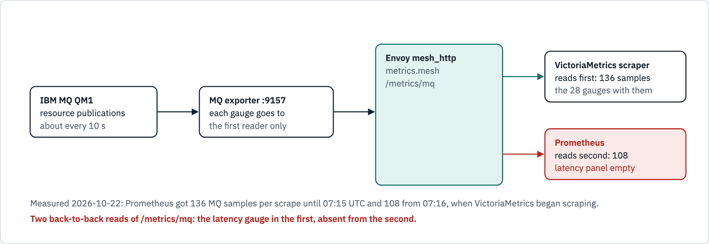
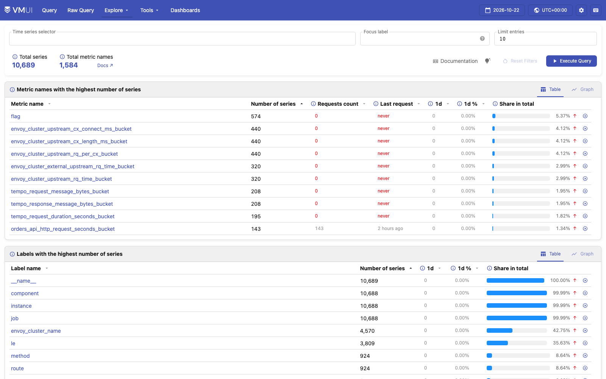

# Prometheus remote write to VictoriaMetrics

This page explains why the lab has one metrics scraper, Prometheus, which copies every sample it
collects to VictoriaMetrics by **remote write**. It starts with the problem that forced the design,
then shows how it works, why the Prometheus format lets one lab feed two vendors' stores, and how
to check it yourself. Story R1.3 built it; the decisions and reviews are in
[reviews/R1.3.md](reviews/R1.3.md).

## Words used here

| Word | Meaning |
|---|---|
| Scrape | Prometheus asks a target for its metrics over HTTP (`GET /metrics`) on a fixed interval: a **pull** |
| Exporter | The small web endpoint that turns a program's state into Prometheus text, such as IBM MQ's on port 9157 |
| Sample | One value of one series at one time, such as MQ's recovery-log write latency, `0.000282` seconds at one scrape |
| Gauge, counter | A gauge goes up and down (a latency now); a counter only goes up (messages put so far) |
| WAL | Prometheus's write-ahead log: every sample is written there before anything else uses it |
| Remote write | Prometheus **pushes** the samples it collected to another store over HTTP (`POST`), in batches |

## The issue: a second scraper took IBM MQ's gauges away from Prometheus

R1.3's first build let VictoriaMetrics scrape the same targets as Prometheus, with the same
`prometheus.yml`. On the live lab that broke something that already worked:

- **Measured.** Prometheus received 136 samples from every MQ scrape until 07:15 UTC on
  2026-10-22, and 108 from 07:16, the minute VictoriaMetrics began scraping. The 28 missing
  samples were all queue-manager gauges (`ibmmq_qmgr_*`: CPU, memory, log and file-system
  figures). The dashboard's existing panel "Queue manager: recovery log write latency" went
  empty on Prometheus, while VictoriaMetrics had all 136.
- **Reproduced.** Two reads of `/metrics/mq`, one straight after the other: the latency gauge
  was in the first answer and absent from the second.
- **Cause, in IBM's source.** The MQ container's exporter
  ([`internal/metrics`](https://github.com/ibm-messaging/mq-container/tree/master/internal/metrics))
  receives the queue manager's resource publications and caches them. On every read,
  `exporter.go`'s `Collect()` resets each gauge and refills it only from the publications cached
  since the previous read, and `update.go` then clears that cache. So **each gauge goes to whoever
  reads first**. Counters are not affected: they only add up.



*Before the fix: two scrapers of one exporter that hands each gauge to the first reader.*

```text
IBM MQ QM1 --publications--> MQ exporter :9157 --> Envoy (metrics.mesh/metrics/mq)
                                                     |--> VictoriaMetrics scraper: read first, 136 samples
                                                     '--> Prometheus: read second, 108 samples (28 gauges gone)
```

**The fix: one scraper.** Prometheus scrapes every target exactly as before and remote-writes
every sample to VictoriaMetrics; VictoriaMetrics scrapes nothing. Measured on the live lab after
the change: MQ sends 136 samples per scrape to **both** stores, and the latency gauge is in both.

## The design: scrape once, copy every sample


*After the fix: one scrape per target, one copy of every sample. Solid arrows carry data; the
dashed one is a check, not traffic.*

```text
1 SCRAPE  IBM MQ and 10 more targets --> Envoy (metrics.mesh) --> Prometheus, every 10 s
2 STORE   Prometheus writes every sample to its TSDB and its WAL
3 COPY    remote_write queue (tails the WAL) --> Envoy (victoriametrics.mesh, POST /api/v1/write)
                                             --> VictoriaMetrics (no scraper of its own)
READ      Grafana: Prometheus by default, VictoriaMetrics from the Datasource menu
CHECK     tests/parity.py: VictoriaMetrics rate[5m] at T equals Prometheus rate[310s] at T
```

In order:

1. **Scrape.** Every 10 seconds Prometheus reads each of its 11 jobs through Envoy's
   `metrics.mesh` (it shares a network with Envoy only, so it cannot reach a target directly).
   The MQ exporter now has a single reader, so no gauge is lost.
2. **Store.** Each sample goes to Prometheus's WAL and its time-series database (TSDB). Prometheus
   stays the dashboard's default store.
3. **Copy.** Prometheus's remote-write queue reads the WAL and sends the samples to
   VictoriaMetrics in batches: up to 2000 samples, or whatever arrived within 5 seconds (Prometheus
   v3.15.0 defaults). Each batch is an HTTP `POST` of snappy-compressed protobuf, as the
   [Remote-Write 1.0 specification](https://prometheus.io/docs/specs/remote_write_spec/) defines.
   It goes through Envoy too: Prometheus reaches VictoriaMetrics only as `victoriametrics.mesh`.
4. **Read.** Grafana reads Prometheus by default; its Datasource menu switches the same dashboard
   to VictoriaMetrics.
5. **Check.** `tests/parity.py` compares ten dashboard queries in both stores. Because
   VictoriaMetrics holds Prometheus's own samples, the comparison is exact: VictoriaMetrics'
   `rate(x[5m])` at a time T equals Prometheus's `rate(x[310s])` at T (both divide the same two
   samples' increase by the time between them), to floating-point noise.

**When something fails.** The specification asks a receiver for a 5xx when a write may be
retried. Prometheus retries a 5xx or a refused connection with a growing pause (30 ms up to 5 s)
and keeps reading from the WAL, so a short VictoriaMetrics outage leaves no gap once it is back
(reviewers read this in `storage/remote/client.go`; not measured by stopping the store). If
Prometheus itself restarts, it sends only samples newer than its start (`tsdb/wlog/watcher.go`),
so up to one unsent batch, about 5 seconds, can be missing from VictoriaMetrics.

**The trade-off.** VictoriaMetrics now depends on Prometheus: if Prometheus stops, both stores
stop receiving. For this lab that is right, because the point is to compare two stores on the
same data, and IBM MQ allows one reader.

## This kind of design, in brief

A metrics pipeline has three jobs: **collect** (read the targets), **store**, and **query**. In a
pull design the collector decides when to read, so it is the one place that knows what was read
and when. Remote write separates collecting from storing: one collector, any number of stores,
each receiving the same samples. The usual reasons to use it:

- **One reader per target**, when a target cannot serve two (IBM MQ here) or should not carry
  the load of two.
- **Identical data in every store**, so stores can be compared, migrated or run side by side
  without arguing about which one missed a scrape.
- **Central or long-term storage**: a collector near the targets pushes to a store elsewhere,
  without that store needing a route back to each target.

The alternative, every store scraping for itself, keeps the stores independent of each other
but doubles the load on every target and, with an exporter like MQ's, gives each store part of
the data.

## Why the Prometheus format makes a multivendor setup possible

The Prometheus format is not one product's private interface. At each of the three jobs there
is a published, shared contract, and products from different vendors meet at it:

| Job | The shared contract | In this lab | Elsewhere |
|---|---|---|---|
| Expose | The text [exposition format](https://prometheus.io/docs/instrumenting/exposition_formats/), stable since 2014; its successor OpenMetrics moved under the Prometheus project in 2024 ([CNCF](https://www.cncf.io/blog/2024/09/18/openmetrics-is-archived-merged-into-prometheus/)) | IBM MQ, Envoy, Postgres's exporter, the OpenTelemetry Collector and the stores all expose it, from different vendors and projects | the IBM MQ container is documented as an endpoint Prometheus can query ([IBM](https://www.ibm.com/docs/SSFKSJ_9.4.0/container/ctr_monitoring.html)) |
| Move | The [Remote-Write 1.0 specification](https://prometheus.io/docs/specs/remote_write_spec/) (published April 2023) | Prometheus writes to VictoriaMetrics' `/api/v1/write` ([VictoriaMetrics](https://docs.victoriametrics.com/victoriametrics/integrations/prometheus/)) | [Thanos Receive](https://thanos.io/v0.34/components/receive.md/), Amazon Managed Service for Prometheus ([`/api/v1/remote_write`](https://docs.aws.amazon.com/prometheus/latest/userguide/AMP-APIReference-RemoteWrite.html)), [Elastic](https://www.elastic.co/docs/manage-data/data-store/data-streams/tsds-ingest-prometheus-remote-write) and Grafana Mimir ([`/api/v1/push`](https://grafana.com/docs/mimir/next/get-started/)) accept it |
| Query | The Prometheus HTTP query API and PromQL | Grafana's Prometheus datasource draws the same dashboard from Prometheus or VictoriaMetrics; all 31 queries answer on both | any store that answers that API can sit behind the same dashboards |

What that buys in practice:

- **A store can be added, replaced or compared by changing a URL**, not the services'
  instrumentation: here one `remote_write` line and one Envoy route added a second vendor's store.
- **Nothing in the services is tied to the store.** MQ, Envoy and Postgres know nothing about
  VictoriaMetrics; they expose the same text they always did.
- **The comparison is fair.** Same samples, same queries, same dashboard: the parity table in
  [chapter 1](story/01-turn-the-lights-on.md) is ten queries matched to floating-point noise.

**The limit this lab measured.** A shared format does not mean every target tolerates many
readers. IBM MQ's exporter is consume-on-read: two scrapers each get part of the data. Fan out
**after** the single reader (remote write), not by adding readers.

## How it is wired in the lab

| Piece | File | What it does |
|---|---|---|
| `remote_write` | [`observability/prometheus.yml`](../observability/prometheus.yml) | `url: http://victoriametrics.mesh:18080/api/v1/write`; every scrape job unchanged |
| The alias | [`compose.yaml`](../compose.yaml) | Envoy answers as `victoriametrics.mesh` on `net-obs`, Prometheus's only network |
| The route | [`envoy/envoy.yaml`](../envoy/envoy.yaml) | on `victoriametrics.mesh`, `POST /api/v1/write` to VictoriaMetrics, retried only if the request never reached it |
| No scraper | [`compose.yaml`](../compose.yaml) | VictoriaMetrics runs with `-storageDataPath` only: no `-promscrape.config` |
| The host gets the whole app | [`envoy/envoy.yaml`](../envoy/envoy.yaml) | from this Mac, `victoriametrics.fabric.localtest.me:8080` routes everything, vmui included, as `prometheus.fabric.localtest.me` does; a container gets only the read API there, and on the mesh only Prometheus's remote write and the collector's OTLP write reach the store |

```yaml
# observability/prometheus.yml
remote_write:
  - url: http://victoriametrics.mesh:18080/api/v1/write
```

The write route is open to any caller on the mesh, as VictoriaMetrics' OpenTelemetry write route
already was. From this Mac, `victoriametrics.fabric.localtest.me:8080` is VictoriaMetrics' whole
app, its own UI included (below).

## How we know it works

Measured on the live lab, 2026-10-22:

| Check | Result |
|---|---|
| MQ samples per scrape | 136 in Prometheus and 136 in VictoriaMetrics; the latency gauge in both |
| Remote-write health (Prometheus's own `/metrics`) | `prometheus_remote_storage_samples_failed_total` 0, `..._retried_total` 0 |
| What VictoriaMetrics received | `vm_rows_inserted_total` by type: `promremotewrite` only (plus 5 rows from OpenTelemetry's test run); no scraped rows |
| Parity | 10 of 10 queries equal to floating-point noise (`tests/parity.py`) |
| `scripts/verify.sh phase6` | "stores: MQ gauge and sample count copied": the gauge in both stores, equal positive sample counts |
| `scripts/run.sh --fresh` | 87 checks, 0 failures; every check of the run before R1.3 still passes |

## See it in VictoriaMetrics' own UI

VictoriaMetrics ships its own web app, vmui, at
<http://victoriametrics.fabric.localtest.me:8080/vmui/>: a query page with graphs, and an
explorer of what the store holds. Apart from the few test metrics `phase6` sends through the
collector over OpenTelemetry, every series in it was scraped by Prometheus and arrived by remote
write.


*vmui's query page, 2026-10-22, with no load running: the shop's requests per second through
Envoy, one line per application upstream. The worker getting messages through MQ's REST API
(`mq_web`) and Prometheus scraping orders-api every 10 s (`orders_api_internal`) keep it moving.*



*The cardinality explorer, the same day: 10,689 series under 1,584 metric names; the most
series belong to the `flag` metric, which VictoriaMetrics, VictoriaLogs and VictoriaTraces
each expose about themselves, and to Envoy's histogram buckets.*

Both pictures are taken by `tests/vmui_capture.py`, which fails rather than takes them when a
page errors, a request answers 400 or more, or the expected text is missing:

```bash
~/.local/share/diagram-kit/.venv/bin/python tests/vmui_capture.py docs/screenshots
```

To see the MQ samples this page is about, type `scrape_samples_scraped{job="mq"}` on the query
page and press **Execute**.

## Check it yourself

With the lab up (`scripts/run.sh`), from the demo directory:

```bash
# MQ's samples per scrape, in each store: both should say 136
for store in prometheus victoriametrics; do
  printf '%s: ' "${store}"
  curl -s "http://${store}.fabric.localtest.me:8080/api/v1/query" \
    --data-urlencode 'query=scrape_samples_scraped{job="mq"}' \
    | python3 -c 'import json, sys; print(json.load(sys.stdin)["data"]["result"][0]["value"][1])'
done

# Remote write's health, from Prometheus's own metrics: failed and retried should be 0
curl -s http://prometheus.fabric.localtest.me:8080/metrics \
  | grep -E '^prometheus_remote_storage_samples_(total|failed_total|retried_total)'

# The two stores compared, query by query
python3 tests/parity.py
```

## Sources

- IBM MQ container metrics: [IBM documentation](https://www.ibm.com/docs/SSFKSJ_9.4.0/container/ctr_monitoring.html);
  the exporter's source, [`internal/metrics`](https://github.com/ibm-messaging/mq-container/tree/master/internal/metrics)
  (`exporter.go`, `update.go`).
- [Prometheus Remote-Write 1.0 specification](https://prometheus.io/docs/specs/remote_write_spec/);
  [exposition formats](https://prometheus.io/docs/instrumenting/exposition_formats/);
  [OpenMetrics merged into Prometheus](https://www.cncf.io/blog/2024/09/18/openmetrics-is-archived-merged-into-prometheus/).
- Receivers: [VictoriaMetrics](https://docs.victoriametrics.com/victoriametrics/integrations/prometheus/),
  [Thanos Receive](https://thanos.io/v0.34/components/receive.md/),
  [Amazon Managed Service for Prometheus](https://docs.aws.amazon.com/prometheus/latest/userguide/AMP-APIReference-RemoteWrite.html),
  [Elastic](https://www.elastic.co/docs/manage-data/data-store/data-streams/tsds-ingest-prometheus-remote-write),
  [Grafana Mimir](https://grafana.com/docs/mimir/next/get-started/).
- The lab's own record: [reviews/R1.3.md](reviews/R1.3.md), `output/transcript.txt`.

## Diagram sources

The two figures are drawn in [`diagrams/remote-write/source.html`](diagrams/remote-write/source.html)
with diagram-kit. After changing it, render both themes again and check them:

```bash
~/.local/share/diagram-kit/.venv/bin/diagram-render docs/diagrams/remote-write/source.html \
  docs/diagrams/remote-write the-issue,the-design
```

The picture, its text twin above and the page change together.
