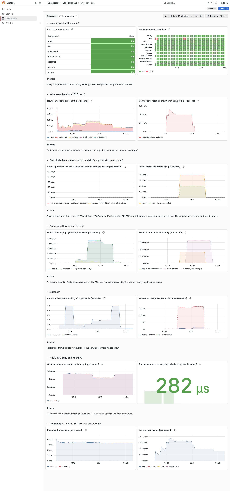
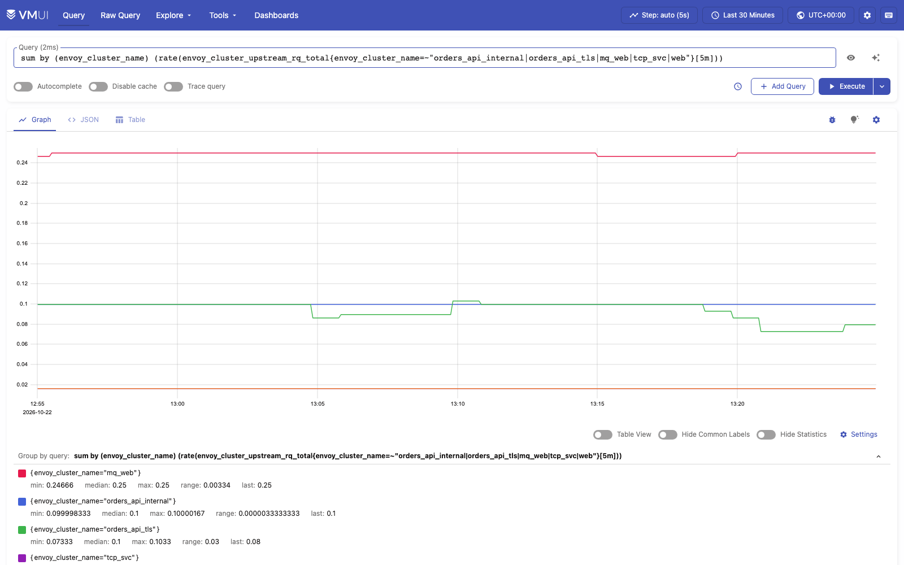

# Chapter 1 — "Turn the lights on" (in progress)

Release 1 gives Fabric Coffee its telemetry before any new feature: one OpenTelemetry Collector
as the only pipeline, traces in Tempo (and VictoriaTraces, compared), metrics in
VictoriaMetrics beside Prometheus, logs in VictoriaLogs. This page grows with each story; the
numbers come from the review records in [../reviews/](../reviews/). The sprint 1 walk's pictures
come from `tests/sprint1_walk.py`, R1.10's from `tests/vmui_capture.py` and R1.4's from
`tests/trace_capture.py`.

## Where we are

| Sprint | Story | Status | Built by, reviewed by | Record |
|---|---|---|---|---|
| 1 | R1.1 The collector is the one pipeline | done | Codex, OB3 | [R1.1](../reviews/R1.1.md) |
| 1 | R1.2 The stores are running | done | OB3, Codex | [R1.2](../reviews/R1.2.md) |
| 1 | R1.3 Side by side, compared | done | Codex, OB3 and OB1-lite | [R1.3](../reviews/R1.3.md) |
| 1 | E1 CI checks demo 57 on every pull request | done | OB3, Codex and OB1-lite | [E1](../reviews/E1.md) |
| 1 | R1.10 VictoriaMetrics' own UI from the Mac | done (#93) | the orchestrator; Codex and OB1-lite | [R1.10](../reviews/R1.10.md) |
| 2 | R1.4 Zero-code auto-instrumentation | done (#114) | designed by Codex and OB1-lite, built from OB1-lite's design; reviewed by Codex and OB3 | [R1.4](../reviews/R1.4.md) |
| 2 | R1.5–R1.9 One order, one story | not started | — | [BACKLOG](../roadmap/BACKLOG.md) |

## Sprint 1: the pipeline and the stores

Every signal reaches the collector only through Envoy (`otlp.mesh`), and the collector reaches
each store only through Envoy too; Envoy routes each store's write path, the read API Grafana
uses and its readiness probe, and nothing else. From the Mac, Grafana, Prometheus and
VictoriaMetrics are each the whole app.


*The telemetry layer. Solid is built and checked; dashed is sprint 2.*


*R1.1: the collector's own counter of accepted spans, scraped by Prometheus through Envoy,
over one hour of building (2026-10-21 23:25 to 2026-10-22 00:24 UTC): each step up is a
`phase6` or `telemetrygen` run arriving; each drop is the collector restarting, its counter
starting again from zero.*

| What was measured | Result |
|---|---|
| `verify.sh phase6` | 22 of 22: the collector, each store's readiness and metrics through Envoy, all five datasources, one run found in every store, the same metric jobs and MQ samples in both metric stores |
| One run's 5 traces | the same 5 trace ids in Tempo and VictoriaTraces |
| VictoriaTraces stopped for 3 min 40 s while traces were sent | all 5 delivered after it returned; the collector retried 57 times and dropped nothing |
| The stores' routes | 45 of 45 route checks: on the mesh, 16 refused with Envoy's own 404 (5 admin or delete APIs, a write and a read path the route does not allow, and 9 allowed paths asked with the wrong method) and 13 allowed (the read APIs, the readiness probes and remote write); from the Mac, VictoriaMetrics' whole app; from a container, its read API only (4 refusals) |
| Tempo 3.1 single binary | 25 ms to start, 32 MB idle, no Kafka |
| Memory in the 3887 MB Podman VM | 1098 to 1203 MB available (three samples, 13:52 to 13:53 UTC) with all 15 long-running services up (the 16th, `init`, exits once it has prepared the volumes); MQ 1.18 GB, every other service under 200 MB |
| `scripts/run.sh --fresh`, everything from nothing | 11 min 7 s, 87 checks, 0 failures (`output/transcript.txt`, 2026-10-22, with R1.10) |

## The walk: one run, followed through every store

One named run (`walk-ab190b56`: 5 traces, 2 minutes of metrics, 5 log lines carrying one of
the trace ids), sent by `telemetrygen` through Envoy to the collector on 2026-10-22, on the lab
rebuilt from nothing, then followed in the browser by `tests/sprint1_walk.py`. Each picture is a
step the script clicks; it fails, rather than takes the picture, when the step does not show
what it should.

### 1. Sign in to Grafana


*Grafana's own sign-in form, user `admin` (the lab password is in `secrets/`, documented in
`docs/usage.md`). The anonymous viewer can read the dashboard but not Explore or data sources.*

### 2. Grafana knows every store


*Five data sources, every URL an Envoy alias (`*.mesh:18080`): Grafana reaches no store
directly.*

### 3. Each one answers its test

The data sources are provisioned from files, so Grafana offers **Test**, not "Save & test".


*Prometheus: "Successfully queried the Prometheus API", through `prometheus.mesh`.*


*VictoriaMetrics answers the same Prometheus API, through `victoriametrics.mesh`.*


*VictoriaLogs, through the plugin baked into the Grafana image. Before the fix below, this page
also showed an error.*


*Tempo, through `tempo.mesh`.*


*VictoriaTraces, read with Grafana's built-in Jaeger data source at
`victoriatraces.mesh:18080/select/jaeger`.*

### 4. The run's traces in Tempo


*TraceQL `{resource.service.name="walk-ab190b56"}` finds the run's 5 traces.*

### 5. One trace opened, by clicking it


*Clicking a trace id opens it: telemetrygen's root span and its one child.*

### 6. The same trace in VictoriaTraces


*The collector sent the same trace to both stores; R1.3 compares them on every trace.*

### 7. The run's metrics in VictoriaMetrics


*Two minutes of OTLP metrics, one sample a second, stored with their dotted OpenTelemetry label
names (`service.name`).*

### 8. The run's log lines in VictoriaLogs, found by trace id


*Looked up by the trace id from step 5: the first sight of chapter 1's goal, a trace's logs one
query away. Sprint 2 makes the services write such lines themselves.*

### 9. Prometheus scrapes everything through Envoy


*All 11 targets up, each `metrics.mesh:18080/metrics/<component>`: Prometheus, too, sees only
Envoy.*

## R1.3: the two metric stores, side by side

Prometheus scrapes every component, as before, and copies every sample it scraped to
VictoriaMetrics by remote write, through Envoy. VictoriaMetrics does not scrape: IBM MQ's
exporter hands each queue-manager gauge to the first reader only, and a second scraper took 28
of them from Prometheus, emptying the dashboard's MQ latency panel (measured, then fixed; see
[the review record](../reviews/R1.3.md), and [the remote-write page](../remote-write.md) for the
design and its workflow).



*The same dashboard on VictoriaMetrics (2026-10-22). Prometheus stays the default; the
Datasource menu at the top offers VictoriaMetrics beside it.*

`python3 tests/parity.py`, in the fresh run (`output/transcript.txt`, 2026-10-22, evaluated at
18:51:49 UTC, once every rate was exactly comparable). For a rate the expected value is
Prometheus's rate over [310s], which holds the same samples VictoriaMetrics' [5m] rate uses;
for the rest it is Prometheus's own value. Each is matched to float precision:

| Query | Prometheus series | VictoriaMetrics series | Max difference from the expected value | Verdict |
|---|---:|---:|---:|---|
| Each component, now | 11 | 11 | 0 (allowed 1e-09) | PASS |
| New connections per tenant (per second) | 1 | 1 | 0 (allowed 2.00002e-11) | PASS |
| Connections reset: unknown or missing SNI (per second) | 1 | 1 | 4.33681e-19 (allowed 3.44828e-12) | PASS |
| Envoy's retries to orders-api (per second) | 1 | 1 | 0 (allowed 0) | PASS |
| Orders created, replayed and processed (per second) | 1 | 1 | 0 (allowed 6.89655e-12) | PASS |
| Events that needed another try (per second) | 1 | 1 | 0 (allowed 0) | PASS |
| Queue manager: messages put and got (per second) | 1 | 1 | 0 (allowed 1.31667e-09) | PASS |
| Queue manager: recovery log write latency, now (seconds) | 1 | 1 | 0 (allowed 2.77e-13) | PASS |
| Postgres: transactions (per second) | 1 | 1 | 4.44089e-16 (allowed 3.51e-09) | PASS |
| tcp-svc: commands (per second) | 1 | 1 | 0 (allowed 2.33333e-11) | PASS |

Traces: one of the run's traces holds 2 spans in Tempo and 2 in VictoriaTraces (`phase6`).

## R1.10: VictoriaMetrics' own UI

VictoriaMetrics ships a web app of its own, vmui. Envoy now passes every path on
`victoriametrics.fabric.localtest.me:8080` to it, as it does for Prometheus, so its query page
and cardinality explorer open from the Mac
(<http://victoriametrics.fabric.localtest.me:8080/vmui/>). Only the Mac gets the whole app: a
container asking the same host name gets the read API alone, and a component on the mesh still
gets only what `victoriametrics.mesh` routed before (the read API, remote write, OpenTelemetry
metrics and the readiness probe). The review found that Envoy's ops listener is on every network
Envoy joins, so Envoy now tells the Mac's connections from a container's.



*vmui on the lab, 2026-10-22, taken by `tests/vmui_capture.py`; more on
[the remote-write page](../remote-write.md#see-it-in-victoriametrics-own-ui).*

## R1.4: an order, traced

orders-api, the worker and tcp-svc now start under `opentelemetry-instrument`, configured by
`OTEL_*` variables alone. One order through the edge is a trace of 12 orders-api spans in Tempo
and in VictoriaTraces: the request, its SQL statements and the event put on IBM MQ. The worker's
status update joins orders-api's server span across Envoy in a trace of its own until R1.5
carries the trace through MQ.


*One order's trace in Tempo, 2026-10-22, taken by `tests/trace_capture.py`; the whole of it, and
what is not traced yet, on [the tracing page](../tracing.md).*

## Found by looking

The walk found what the checks and both reviews had not.


*Before the fix (2026-10-22 01:21 UTC): the data source test passes, yet the page reports
`Unexpected token 'o', "not routed "... is not valid JSON`.*

Envoy's access log named the request: `POST /select/tenant_ids`, a read the plugin makes when
its settings page opens, which R1.2's route list did not allow; Envoy answered with its own
`not routed` text, which the plugin tried to parse as JSON. Grafana's alerting view likewise
asks VictoriaMetrics for `GET /api/v1/rules`. Both are read-only, and both are now routed, with
three route tests; step 3 above shows the page after the fix.

## Sprint 1 review

The sprint's goal, "every store up behind Envoy, fed by the collector, compared side by side",
is met. Each story is in [the backlog](../roadmap/BACKLOG.md) with its measured status, and in
its review record.

| Story | What it added |
|---|---|
| R1.1 | One OpenTelemetry Collector, reached only through Envoy's `otlp.mesh`, its own metrics scraped |
| R1.2 | Tempo, VictoriaTraces, VictoriaMetrics and VictoriaLogs, each on its own network behind Envoy; five Grafana datasources |
| R1.3 | Prometheus as the one scraper, remote-writing to VictoriaMetrics; ten dashboard queries compared exactly; the dashboard on either store |
| E1 | CI on every pull request that touches the demo: three jobs, every test named or run |
| R1.10 | VictoriaMetrics' own UI from the Mac |

How the recorded run changed across sprint 1: `output/transcript.txt` at each commit named in
the table; the checks are its `PASS` lines, the time runs from its first step to its last.

| | Demo 57's first commit (`6d5a505`) | R1.1 and R1.2 merged (`3968e47`) | R1.3 and E1 merged (`289e0b9`) | R1.10 merged (this page's run) |
|---|---:|---:|---:|---:|
| Checks passing | 65 | 84 | 87 | 87 |
| `scripts/run.sh --fresh` | 5 min 35 s | 8 min 6 s | 11 min 1 s | 11 min 7 s |

The first column is the run recorded in demo 57's first commit, which predates the collector and
the stores that the same commit added; there is no earlier merge to read.

R1.1 and R1.2 added 2 min 31 s, most of it phase 6's checks of the collector and the four stores
(1 min 49 s). R1.3 added 2 min 55 s: its new comparison step waits for a full five-minute rate
window in both stores before it compares, so that the comparison is exact rather than within a
tolerance. That step takes 3 min 16 s (14:25:01 to 14:28:17 UTC in this page's run); the rest of
the run was 21 s faster.

## Sprint 1 retro

**What helped**

- Measuring on the live lab, not only reading the change. The MQ gauges VictoriaMetrics took from
  Prometheus (136 samples a scrape fell to 108) were found in Prometheus's own scrape counts; the
  VictoriaLogs `not routed` error was found by the browser walk, after the data source test and
  both reviews had passed it.
- Two reviewers who did not write the change, then a second pass on the fixed head. R1.3's
  comparison went from a tolerance that could hide a difference to an exact one over four passes.
- CI from the middle of the sprint: R1.3 could not merge until its three new tests were named.

**What hurt**

- The fresh run doubled, from 5 min 35 s to 11 min 7 s: phase 6's checks of the collector and
  the stores added 1 min 49 s, and R1.3's wait for a full rate window 3 min 16 s (MQ's two-minute
  start under emulation was already in the 5 min 35 s), so every full check costs eleven minutes.
- Switching the lab's checkout between branches left running containers on old bind-mounted
  files (an empty web root, empty Grafana dashboards, an old `prometheus.yml`) until `run.sh`
  learned to recreate them.
- Numbers in prose drifted from the run they describe: the CI workflow's header said 11 min 22 s
  for a run of 11 min 1 s, found only while closing the sprint. `tests/scripts/test_recap_counts.sh`
  now pins that number too.

**One change for sprint 2:** a story is ready only when the behaviour it depends on has been
measured on the live lab and recorded, not only its versions and endpoints. R1.3's first design
assumed that a second scraper sees the same data; IBM MQ's exporter does not allow that. Sprint
2's stories already name their spikes (MQ user properties, Envoy's per-attempt spans,
trace-to-logs); this makes it the rule, in [ROADMAP.md](../roadmap/ROADMAP.md)'s Definition of
Ready.

## Re-taking the pictures

```bash
python3 tests/sprint1_walk.py docs/screenshots/sprint1 <run> <trace-id>
```

`<run>` and `<trace-id>` are a telemetrygen service name and one of its trace ids, from a
`verify.sh phase6` run or sent by hand (see the script's header). The script needs Playwright
with Chromium.
