# Chapter 1 — "Turn the lights on" (in progress)

Release 1 gives Fabric Coffee its telemetry before any new feature: one OpenTelemetry Collector
as the only pipeline, traces in Tempo (and VictoriaTraces, compared), metrics in
VictoriaMetrics beside Prometheus, logs in VictoriaLogs. This page grows with each story; the
numbers come from the review records in [../reviews/](../reviews/), the pictures from
`tests/sprint1_walk.py`.

## Where we are

| Sprint | Story | Status | Built by, reviewed by | Record |
|---|---|---|---|---|
| 1 | R1.1 The collector is the one pipeline | done | Codex, OB3 | [R1.1](../reviews/R1.1.md) |
| 1 | R1.2 The stores are running | done | OB3, Codex | [R1.2](../reviews/R1.2.md) |
| 1 | R1.3 Side by side, compared | next | Codex, OB3 | — |
| 2 | R1.4–R1.9 One order, one story | not started; its two mocks await approval | — | [BACKLOG](../roadmap/BACKLOG.md) |

## Sprint 1, so far: the pipeline and the stores

Every signal reaches the collector only through Envoy (`otlp.mesh`), and the collector reaches
each store only through Envoy too; Envoy routes each store's write path, the read API Grafana
uses and its readiness probe, and nothing else.


*The telemetry layer. Solid is built and checked; dashed is sprint 2.*

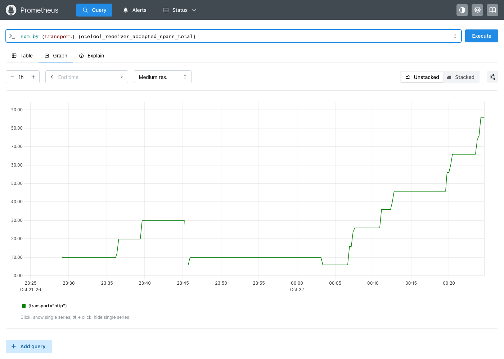

*R1.1: the collector's own counter of accepted spans, scraped by Prometheus through Envoy,
over one hour of building (2026-10-21 23:25 to 2026-10-22 00:24 UTC): each step up is a
`phase6` or `telemetrygen` run arriving; each drop is the collector restarting, its counter
starting again from zero.*

| What was measured | Result |
|---|---|
| `verify.sh phase6` | 19 of 19: the collector, each store's readiness and metrics through Envoy, all five datasources, one run found in every store |
| One run's 5 traces | the same 5 trace ids in Tempo and VictoriaTraces |
| VictoriaTraces stopped for 3 min 40 s while traces were sent | all 5 delivered after it returned; the collector retried 57 times and dropped nothing |
| Envoy and the stores' admin and delete APIs | 29 of 29 route checks: refused with Envoy's own 404, reads allowed |
| Tempo 3.1 single binary | 25 ms to start, 32 MB idle, no Kafka |
| Memory in the 3887 MB Podman VM | 1255 MB still available with all four stores running |
| `scripts/run.sh --fresh`, everything from nothing | 7 min 52 s, 84 checks, 0 failures (`output/transcript.txt`, 2026-10-22) |

## The walk: one run, followed through every store

One named run (`walk-ab190b56`: 5 traces, 2 minutes of metrics, 5 log lines carrying one of
the trace ids), sent by `telemetrygen` through Envoy to the collector on 2026-10-22, on the lab
rebuilt from nothing, then followed in the browser by `tests/sprint1_walk.py`. Each picture is a
step the script clicks; it fails, rather than takes the picture, when the step does not show
what it should.

### 1. Sign in to Grafana


*Grafana's own sign-in form, user `admin` (the lab password is in `secrets/`, documented in
`docs/usage.md`). The anonymous viewer can read the dashboard but not Explore or data sources.*

### 2. Grafana knows every store

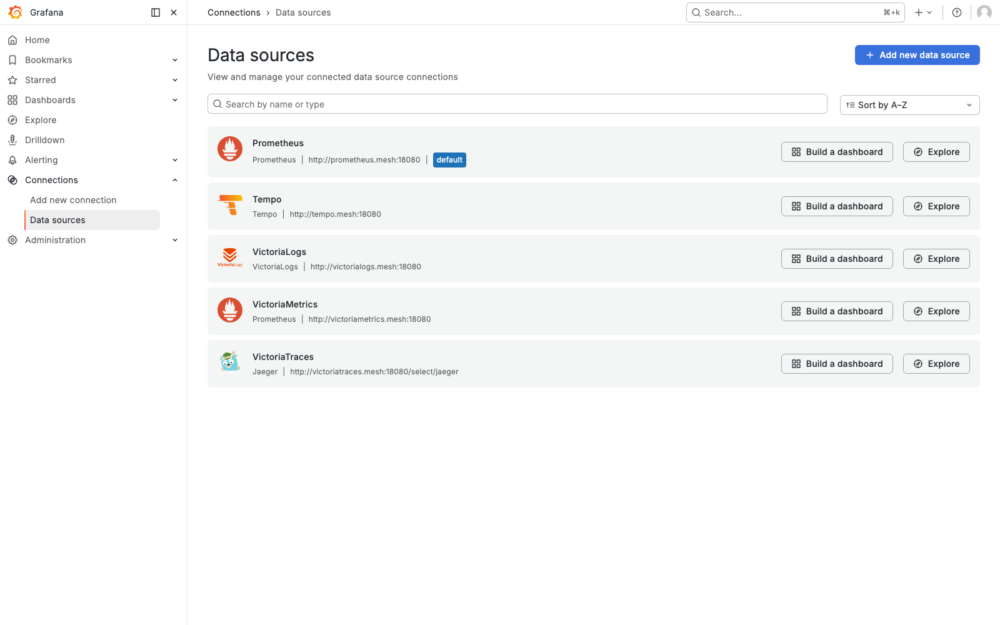

*Five data sources, every URL an Envoy alias (`*.mesh:18080`): Grafana reaches no store
directly.*

### 3. Each one answers its test

The data sources are provisioned from files, so Grafana offers **Test**, not "Save & test".

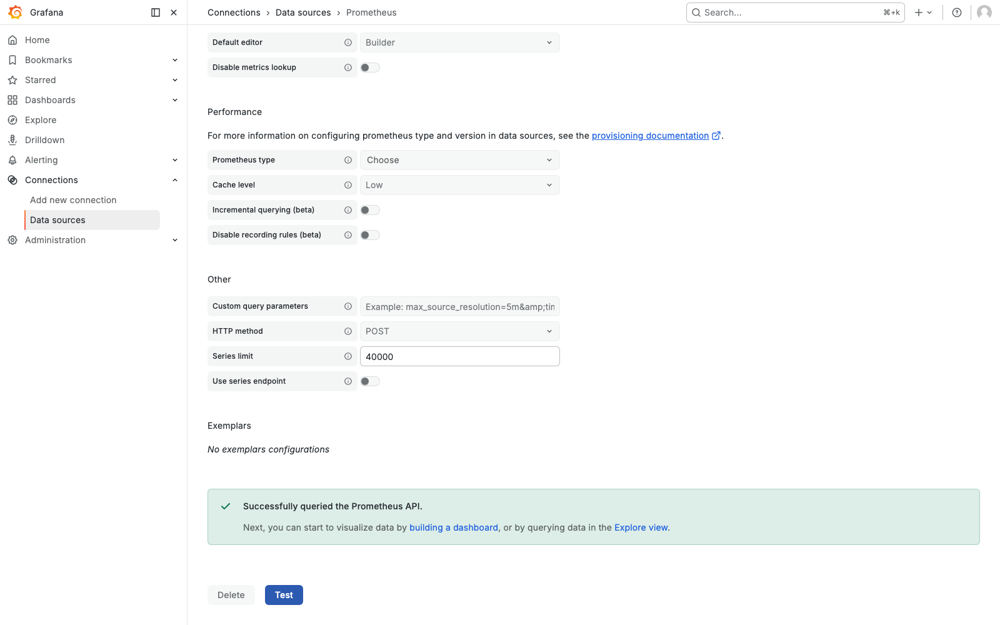

*Prometheus: "Successfully queried the Prometheus API", through `prometheus.mesh`.*

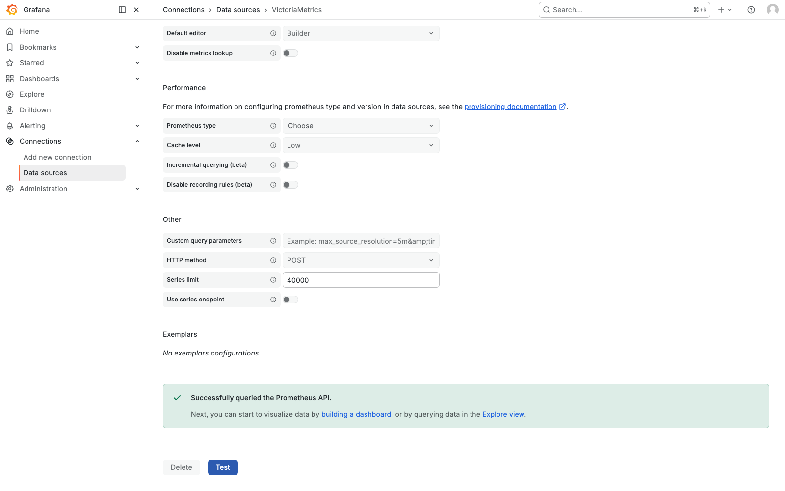

*VictoriaMetrics answers the same Prometheus API, through `victoriametrics.mesh`.*

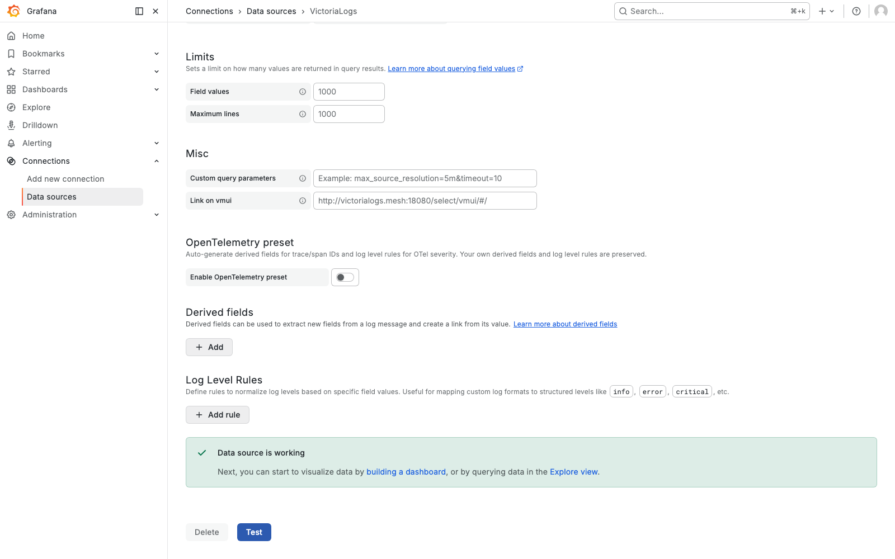

*VictoriaLogs, through the plugin baked into the Grafana image. Before the fix below, this page
also showed an error.*

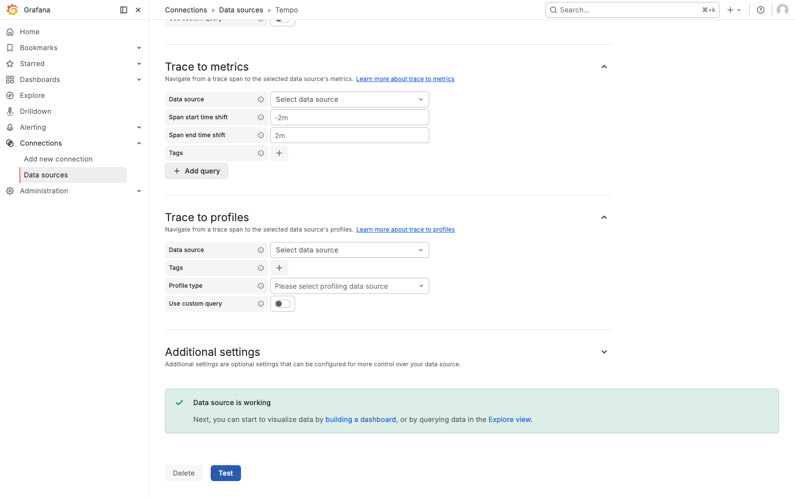

*Tempo, through `tempo.mesh`.*

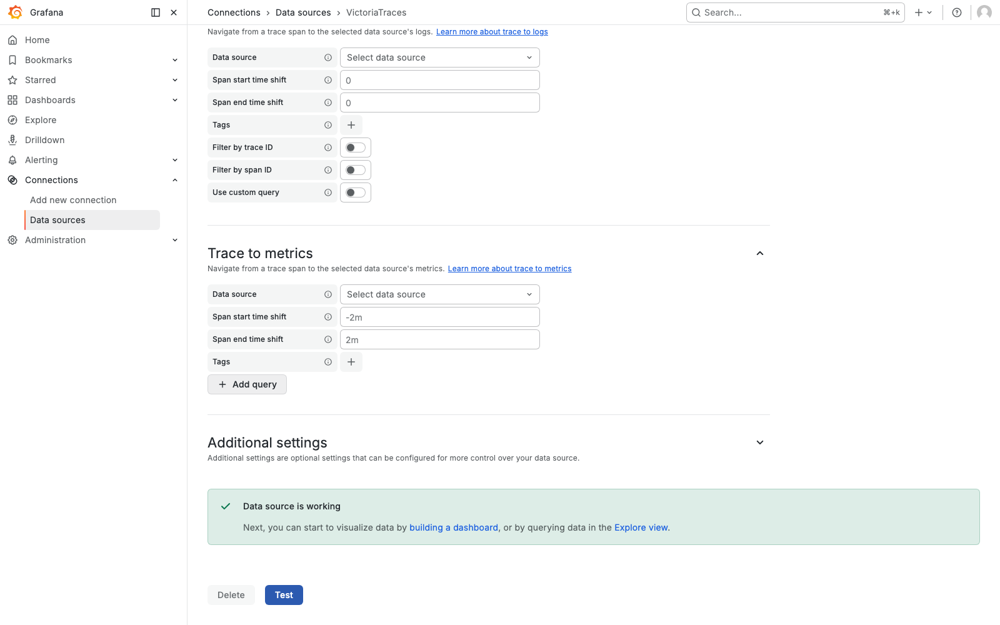

*VictoriaTraces, read with Grafana's built-in Jaeger data source at
`victoriatraces.mesh:18080/select/jaeger`.*

### 4. The run's traces in Tempo

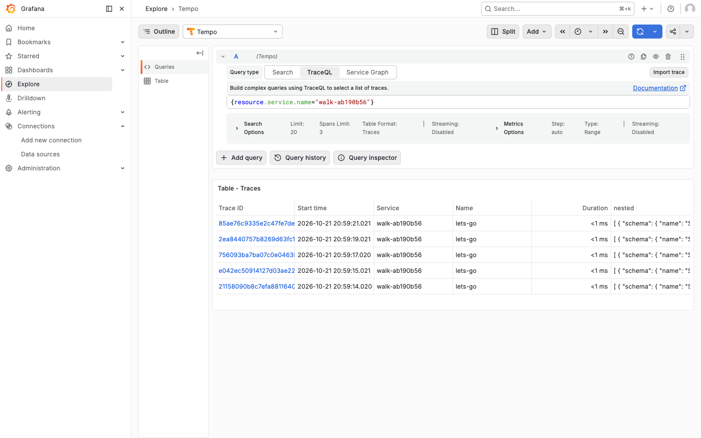

*TraceQL `{resource.service.name="walk-ab190b56"}` finds the run's 5 traces.*

### 5. One trace opened, by clicking it

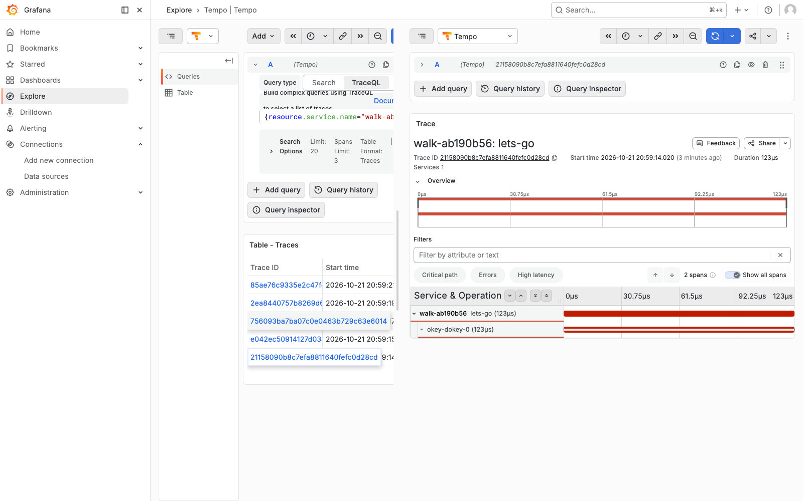

*Clicking a trace id opens it: telemetrygen's root span and its one child.*

### 6. The same trace in VictoriaTraces

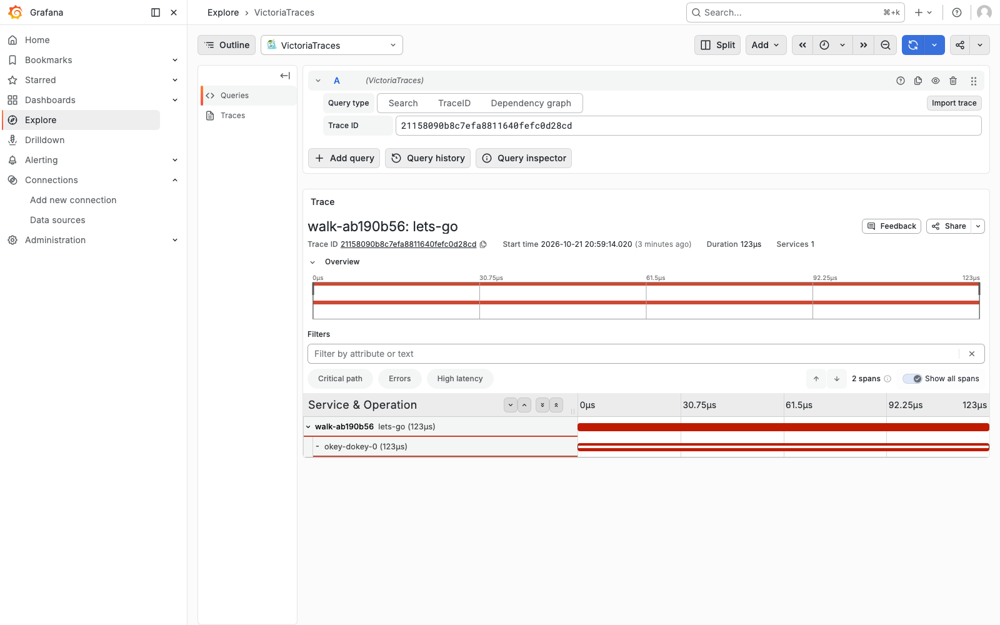

*The collector sent the same trace to both stores; R1.3 compares them on every trace.*

### 7. The run's metrics in VictoriaMetrics

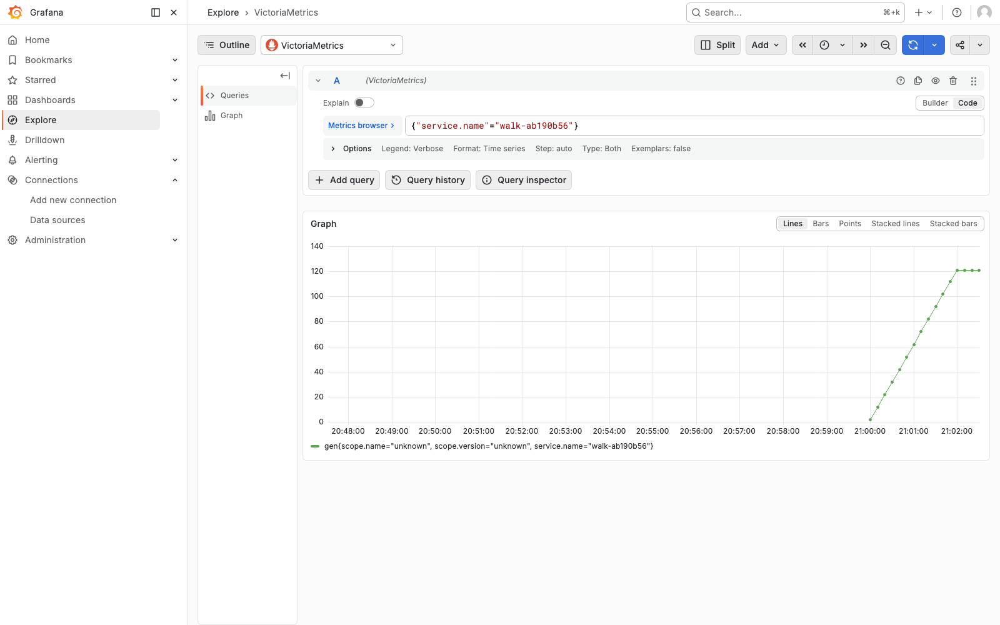

*Two minutes of OTLP metrics, one sample a second, stored with their dotted OpenTelemetry label
names (`service.name`).*

### 8. The run's log lines in VictoriaLogs, found by trace id

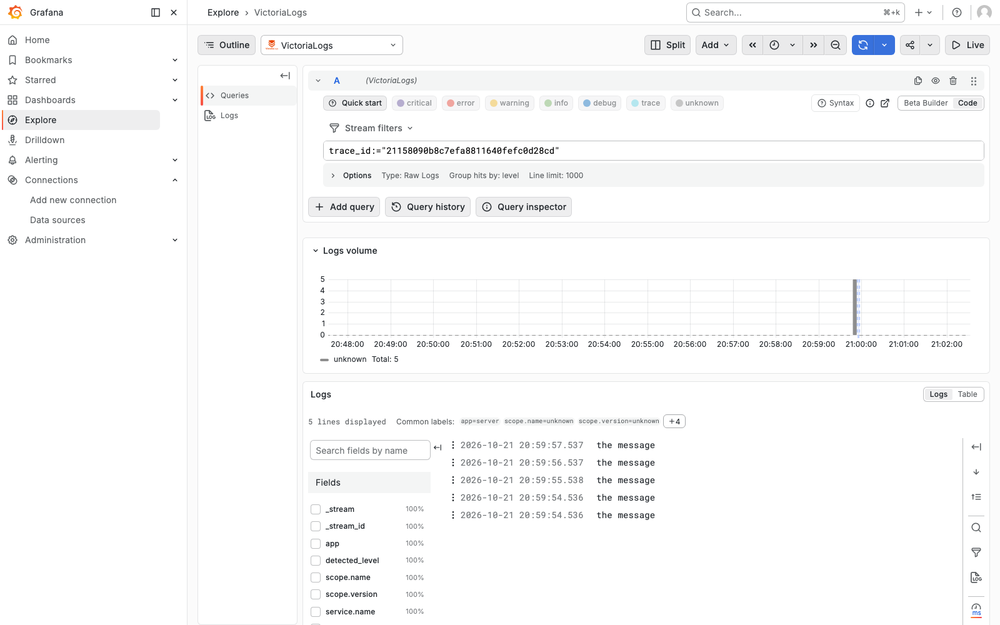

*Looked up by the trace id from step 5: the first sight of chapter 1's goal, a trace's logs one
query away. Sprint 2 makes the services write such lines themselves.*

### 9. Prometheus scrapes everything through Envoy

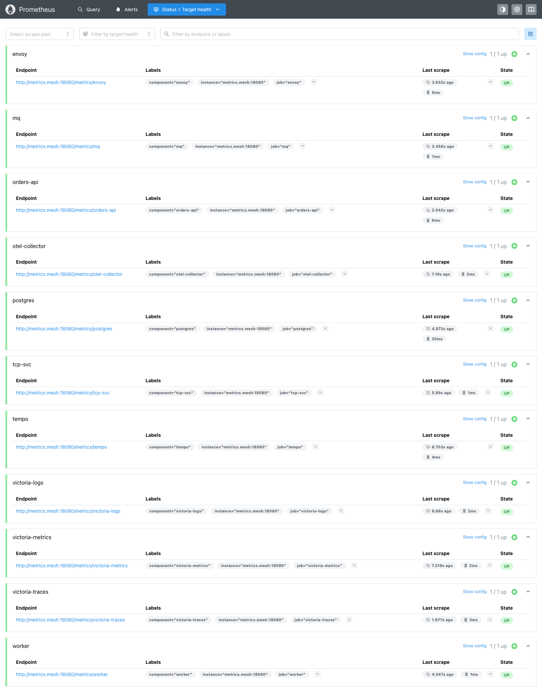

*All 11 targets up, each `metrics.mesh:18080/metrics/<component>`: Prometheus, too, sees only
Envoy.*

## Found by looking

The walk found what the checks and both reviews had not.

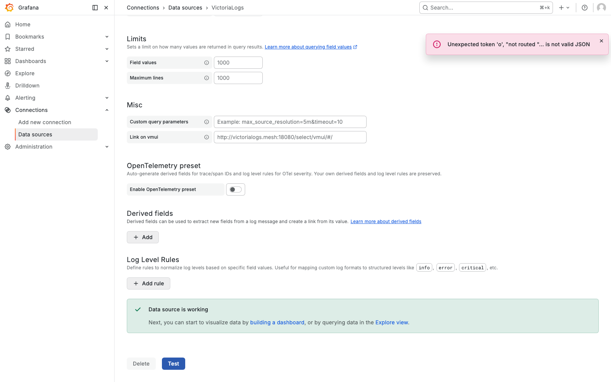

*Before the fix (2026-10-22 01:21 UTC): the data source test passes, yet the page reports
`Unexpected token 'o', "not routed "... is not valid JSON`.*

Envoy's access log named the request: `POST /select/tenant_ids`, a read the plugin makes when
its settings page opens, which R1.2's route list did not allow; Envoy answered with its own
`not routed` text, which the plugin tried to parse as JSON. Grafana's alerting view likewise
asks VictoriaMetrics for `GET /api/v1/rules`. Both are read-only, and both are now routed, with
three route tests; step 3 above shows the page after the fix.

## Re-taking the pictures

```bash
python3 tests/sprint1_walk.py docs/screenshots/sprint1 <run> <trace-id>
```

`<run>` and `<trace-id>` are a telemetrygen service name and one of its trace ids, from a
`verify.sh phase6` run or sent by hand (see the script's header). The script needs Playwright
with Chromium.
