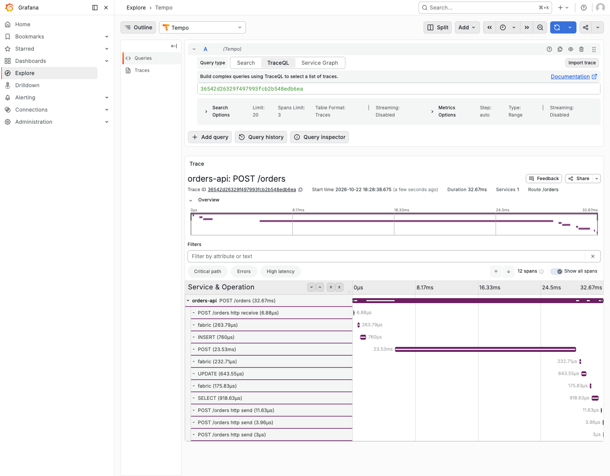
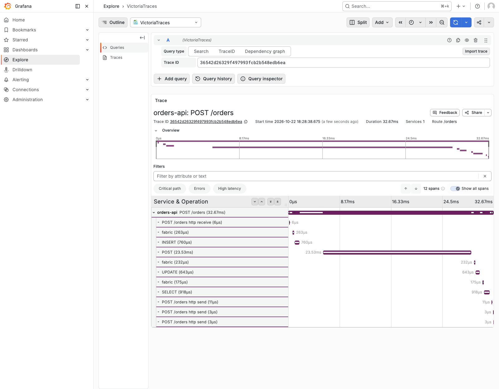
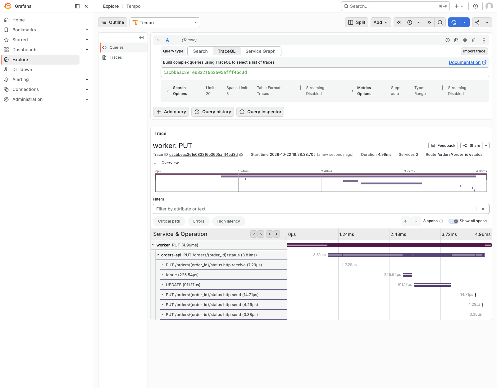
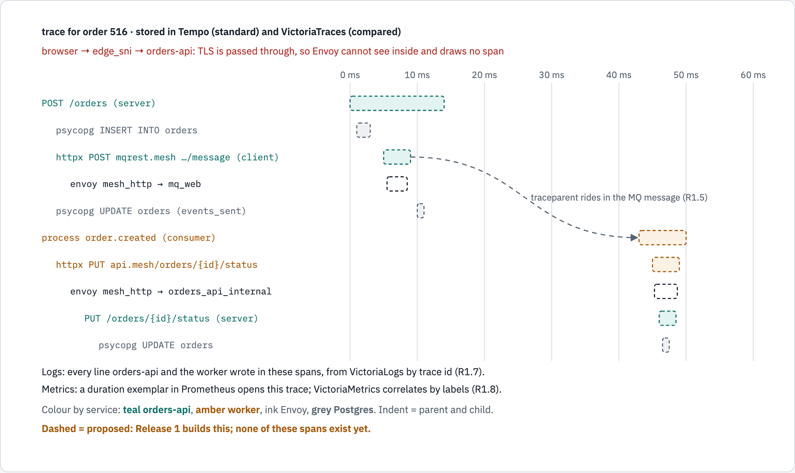

# Tracing, as built

This page explains how the lab traces a request today: how orders-api, the worker and tcp-svc
make spans without a line of tracing code, the path a span takes to Tempo and VictoriaTraces,
what one order's trace holds, and what is not traced yet. Story R1.4 built it; the decisions and
reviews are in [reviews/R1.4.md](reviews/R1.4.md), and this page's own review in
[reviews/115-tracing-page.md](reviews/115-tracing-page.md). Every number here was measured on the
running lab on 2026-10-22, and the output it comes from is named beside it.

## Words used here

| Word | Meaning |
|---|---|
| Span | One timed piece of work, such as one HTTP request served or one SQL statement, with a name, a start, a duration and attributes |
| Trace | The spans of one piece of work, joined by parent and child; they share one 32-hex-digit **trace id** |
| Kind | What a span is to its service: `server` (a request it serves), `client` (a call it makes), `internal` (work inside it) |
| `traceparent` | The W3C Trace Context HTTP header that carries the trace id and the caller's span id to the next service: `00-<trace id>-<parent span id>-01` |
| Instrumentation | A library that wraps another (FastAPI, httpx, psycopg) and makes spans for its calls |
| OTLP | The OpenTelemetry protocol; here, spans as protobuf over HTTP, `POST /v1/traces` |
| Collector | The OpenTelemetry Collector, the one process every span goes through on its way to the stores |
| Resource | The attributes of the process that made a span: `service.name`, `service.version`, `deployment.environment` |

## How a span is made, with no code change

None of the three services imports OpenTelemetry. Each image starts its program under
`opentelemetry-instrument`, which loads the installed instrumentations, configures them from
`OTEL_*` environment variables, and then runs the same command:

```dockerfile
# services/orders-api/Dockerfile
CMD ["opentelemetry-instrument", "python", "-m", "app.main"]
```

What each service installs decides what it traces. The packages are named one by one in each
`requirements.txt` and pinned with hashes in its `requirements.lock`; `opentelemetry-bootstrap`,
which would guess them, is not used.

| Service | Instrumentations | What gets a span |
|---|---|---|
| orders-api | `fastapi`, `httpx`, `psycopg` (all 0.66b1) | every request it serves except the three routes excluded below, every HTTP call it makes, every SQL statement |
| worker | `httpx` | every HTTP call it makes: its MQ gets, its status updates to orders-api, and the puts that requeue or dead-letter an event |
| tcp-svc | none (the distro only) | nothing: it serves raw TCP, which no instrumentation covers |

All three take the same settings from one YAML anchor in [`compose.yaml`](../compose.yaml):

| Variable | Value | Why |
|---|---|---|
| `OTEL_SERVICE_NAME` | `orders-api`, `worker`, `tcp-svc` | the name each trace shows |
| `OTEL_EXPORTER_OTLP_ENDPOINT` | `http://otlp.mesh:18080` | Envoy's alias for the collector; the SDK adds `/v1/traces` |
| `OTEL_EXPORTER_OTLP_PROTOCOL` | `http/protobuf` | required: the distro defaults it to `grpc` (`os.environ.setdefault(OTEL_EXPORTER_OTLP_PROTOCOL, "grpc")` in `opentelemetry.distro`), and the lab routes OTLP over HTTP only |
| `OTEL_TRACES_EXPORTER` | `otlp` | send spans |
| `OTEL_METRICS_EXPORTER`, `OTEL_LOGS_EXPORTER` | `none` | traces only: metrics stay on Prometheus's scrape until R1.8, logs on stdout until R1.7 |
| `OTEL_PROPAGATORS` | `tracecontext,baggage` | read and write the W3C `traceparent` header |
| `OTEL_TRACES_SAMPLER` | `parentbased_always_on` | keep every trace; follow the caller's sampling decision when there is a caller |
| `OTEL_RESOURCE_ATTRIBUTES` | `service.version=dev,deployment.environment=lab` | the resource every span carries; `dev` is the images' tag |
| `OTEL_PYTHON_FASTAPI_EXCLUDED_URLS` | `/metrics$,/healthz$,/readyz$` (orders-api only; `$$` in Compose) | Prometheus's scrape every 10 s and the health check every 5 s would each be a trace |

## The path a span takes


*The telemetry layer. Solid boxes are built and checked; the dashed one, Envoy's own spans, is
R1.6.*

```text
1 MAKE    orders-api, worker: each span ends --> the SDK's batch processor (sends every 5 s)
2 SEND    POST http://otlp.mesh:18080/v1/traces --> Envoy mesh_http, route "otlp" (retried only if never received)
                                                --> otel-collector :4318
3 BATCH   collector: memory_limiter --> batch
4 STORE   collector --> Envoy (tempo.mesh /v1/traces)                                --> Tempo 3.1
                    --> Envoy (victoriatraces.mesh /insert/opentelemetry/v1/traces)  --> VictoriaTraces
5 READ    Grafana --> Envoy (tempo.mesh, victoriatraces.mesh) --> the trace, by id or by search
```

Every span passes Envoy twice on its way to each store, and no service talks to the collector or a
store directly: each sits on its own network with Envoy alone. The collector's trace pipeline is in
[`observability/otel-collector.yaml`](../observability/otel-collector.yaml) (`exporters:
[otlp_http/tempo, otlp_http/victoriatraces]`); Envoy's route is the `otlp` virtual host in
[`envoy/envoy.yaml`](../envoy/envoy.yaml).

## One order's trace

`tests/trace_capture.py` places one order through Envoy's edge with a `traceparent` it made
itself, as `phase6` does, so the trace id is known before any store is asked. Its output, in
[`output/trace-capture.txt`](../output/trace-capture.txt):

```text
order   53 placed, HTTP 201, traceparent 00-36542d26329f497993fcb2b548edb6ea-5edb5814d7a1431f-01
tempo   order trace 36542d26329f497993fcb2b548edb6ea: 12 spans, client=7 internal=4 server=1
vtraces order trace 36542d26329f497993fcb2b548edb6ea: the same 12 span ids
```



*The order's trace in Tempo, 2026-10-22. All 12 spans are orders-api's. The long bar is the
event put on IBM MQ through Envoy (`POST`, 23.53 ms of the request's 32.67 ms).*

The 12 spans, read back from Tempo's API:

| Spans | Kind | Made by | What they are |
|---|---|---|---|
| `POST /orders` | server | FastAPI | the request; its parent is the caller's span from `traceparent` |
| `POST /orders http receive`, 3 × `POST /orders http send` | internal | FastAPI (ASGI) | reading the request body; sending the response start and its body |
| `INSERT`, `UPDATE`, `SELECT` | client | psycopg | the order written, its `events_sent` counted, the row read back |
| 3 × `fabric` | client | psycopg | the connection pool's check before each of those three (`check=AsyncConnectionPool.check_connection` in `app/db.py` runs an empty statement; an empty statement's span takes the database's name) |
| `POST` | client | httpx | the `order.created` event put on `DEV.QUEUE.1` through `mqrest.mesh` |

`phase6` checks the same kind of trace: exactly one server span, and under it at least one HTTP
client span and at least one database span, all in the requested trace. Its summary counts
differently from the table: `client` is the HTTP client spans only (the `POST` to MQ) and
`database` the six psycopg spans, so it reads `server=1 client=1 database=6 traces=1 spans=12`; the
total is printed, not checked.

A trace started by a caller's `traceparent` has its root in the caller, which sends no span, so
Tempo's search lists it as `<root span not yet received>` (`output/tracing-measurements.txt`,
section 5); opened by its id, it shows as above.
An order placed with no `traceparent` (the Orders page's `fetch` sets none, nor does `curl`
alone) starts a trace of its own: `POST /orders` with no parent and the same 12 spans
([`output/tracing-measurements.txt`](../output/tracing-measurements.txt), section 2).

The collector sends the same spans to VictoriaTraces, which Grafana reads with its Jaeger
datasource:



*The same trace in VictoriaTraces: the same 12 span ids, names and durations.*

## The worker's half: a trace of its own until R1.5

The worker gets the event from MQ and reports the order processed with
`PUT /orders/{id}/status`, through Envoy's `mesh_http`. httpx writes `traceparent` on that call,
Envoy passes the header through unchanged, and orders-api continues the worker's trace:



*The worker's trace for order 53: 8 spans, 2 services. The worker's `PUT` is the root; orders-api's
server span is its child, across Envoy, and orders-api's other six spans, the `UPDATE` among them,
sit under that server span.*

```text
tempo   worker trace cacbbeac3e1e083216b3605afff45d3d: 8 spans, client=3 internal=4 server=1
```

So trace context already crosses every HTTP hop on the mesh. What it does not cross is IBM MQ:
the event is a JSON body on a queue, with no `traceparent`, so the order and its processing are
two traces. The worker also has no span of its own around processing a message, so each of its
HTTP calls is a root: in 10 minutes Tempo held 118 worker traces named `DELETE`, its
long-polling gets from `DEV.QUEUE.1` (`GET_WAIT_MS` 5000), and 5 named `PUT`, one for each order
processed in that window (`output/tracing-measurements.txt`, section 1).

R1.5 (#98) carries `traceparent` in the MQ message (the spike measured that MQ's REST API keeps a
user property, `output/spike-r1-5-mq-traceparent.txt`) and gives the worker a span per message,
so one order becomes one trace.

## What is not traced, and why

| What | Traced? | Why |
|---|---|---|
| The browser, the Orders page | no | Envoy's edge passes TLS through on SNI, so nothing at the edge sees the request; browser tracing is out of R1's scope |
| Envoy itself | no | `mesh_http` forwards `traceparent` but makes no span of its own; R1.6 (#99) adds that, and the spike measured one span per retry attempt (`output/spike-r1-6-envoy-attempt-spans.txt`) |
| IBM MQ, Postgres | no | they make no spans; the calling service's client spans time each call (orders-api for Postgres, its event puts and its queue browses; the worker for its MQ gets, requeues and dead-letter puts) |
| orders-api's `/metrics`, `/healthz`, `/readyz` | no | excluded; 0 traces in 30 minutes for each (reviews/R1.4.md) |
| tcp-svc | no span | instrumented, but nothing instruments a raw TCP server; `phase6` checks that it starts under `opentelemetry-instrument` |
| orders-api's background work | yes | the sweeper's `SELECT` every 15 s (`SWEEP_EVERY_S`) and its pool checks are traces of their own (38 and 42 in 10 minutes, reviews/R1.4.md) |
| Logs beside a span | not yet | R1.7 (#100) writes the trace id into every log line and links a span to its logs |

## How we know it works

`scripts/verify.sh phase6` checks tracing on every run. Re-run on 2026-10-22, after R1.4's review
fixes, in [`output/phase6-tracing.txt`](../output/phase6-tracing.txt), `failures: 0`:

| Check | What it proves | Result |
|---|---|---|
| `otel: a span reaches the collector through Envoy` | telemetrygen sends 10 spans through `otlp.mesh` with no export error, and the collector's accepted-span counter rises by at least 10 (the services' own spans count too, so here it rose by 16) | accepted spans 19627 → 19643 |
| `otel: the three services run instrumented` | each service's process 1 has the installed hook directory on its `PYTHONPATH`, and its log holds no `Failed to auto initialize OpenTelemetry` | `orders-api:orders-api:instrumented worker:worker:instrumented tcp-svc:tcp-svc:instrumented` |
| `otel: one order's trace has server, client and database spans` | an order placed with the check's own `traceparent` has, in that trace and under orders-api's server span, orders-api's HTTP and database client spans | `server=1 client=1 database=6 traces=1 spans=12` |
| `otel: resource has service, version, env=lab` | in the order's trace and one worker trace (13 spans here), every orders-api and worker span has a version and `deployment.environment=lab`, and both services appear; a span with no `service.name` counts as missing, and spans of other named services are not checked | `orders-api=dev/lab worker=dev/lab spans=13 missing=0` |

`tests/scripts/test_verify_false_pass.sh` feeds the checks the cases R1.4's reviewers found would
fool them, and wants the right verdict: a service whose hook loaded but failed to start, a
look-alike path on `PYTHONPATH`, another service's or another trace's spans in the order's slots,
a resource without `service.name`. It guards against those known cases, not every possible one,
and needs no lab:

```bash
bash tests/scripts/test_verify_false_pass.sh scripts/verify.sh   # last line: mismatches: 0
```

## Check it yourself

From the demo directory, with the lab running:

```bash
# Place an order with a trace id you choose, through Envoy's edge
trace_id="$(uuidgen | tr -d '-' | tr '[:upper:]' '[:lower:]')"
curl -s -w '\n' --cacert certs/ca/ca.crt -X POST https://api.fabric.localtest.me:8443/orders \
  -H 'Content-Type: application/json' -H "Idempotency-Key: $(uuidgen)" \
  -H "traceparent: 00-${trace_id}-$(uuidgen | tr -d '-' | tr '[:upper:]' '[:lower:]' | cut -c1-16)-01" \
  -d '{"item":"flat white","quantity":1}'
echo "trace id: ${trace_id}"

# Its spans in Tempo (from Grafana's container, which holds tempo.mesh). The services export
# every 5 s, so wait first; Tempo answers a trace it does not hold yet with an empty one.
sleep 10
podman exec fabric-grafana-1 curl -fsS "http://tempo.mesh:18080/api/v2/traces/${trace_id}" \
  | python3 -c 'import json,sys; print(sorted(s["name"] for r in json.load(sys.stdin)["trace"].get("resourceSpans", []) for x in r["scopeSpans"] for s in x["spans"]))'
```

The last command prints the twelve span names of the table above, `fabric` three times; `[]`
means they have not reached Tempo yet, so run it again. To see the trace, open
<http://grafana.fabric.localtest.me:8080/explore>, choose **Tempo**, then **TraceQL**, paste the
trace id and run the query. The pictures on this page are taken by `tests/trace_capture.py`. It
takes them only once each trace holds the spans this page discusses: the order's server span under
the `traceparent` it sent, with `INSERT`, the `POST` to MQ, `UPDATE` and `SELECT` under it; the same
span ids in VictoriaTraces; orders-api's server span and its `UPDATE` under the worker's `PUT`. The
library's own spans (ASGI send and receive, the pool's checks) are counted, not required. Each page
must then show its span count and names, and a run that fails half-way keeps the last set:

```bash
~/.local/share/diagram-kit/.venv/bin/python tests/trace_capture.py docs/screenshots
```

## The twelve factors it touches

The roadmap scores the lab against the twelve factors ([ROADMAP.md](roadmap/ROADMAP.md)). Tracing
as built touches three of them:

| Factor | What R1.4 did |
|---|---|
| II Dependencies | each instrumentation named in `requirements.txt` and pinned with hashes in `requirements.lock`; nothing installed by guessing (`opentelemetry-bootstrap`) |
| III Config | the image's `CMD` starts each service under `opentelemetry-instrument`; everything else (exporter, endpoint, protocol, sampler, resource) is `OTEL_*` variables in `compose.yaml`; the code does not change |
| XI Logs | still open: logs go to stdout as JSON without a trace id; R1.7 adds it and sends them to VictoriaLogs |

## What comes next

The trace R1 aims for, one order from its `POST` through MQ to the worker's update, with Envoy's
hops drawn, is the approved mock in [`diagrams/r1-trace-mock`](diagrams/r1-trace-mock/source.html):
solid for what R1.4 built, dashed for R1.5 and R1.6.



*Solid: built in R1.4. Dashed: proposed for R1.5 and R1.6.*

## Sources

- OpenTelemetry Python zero-code instrumentation:
  [overview](https://opentelemetry.io/docs/zero-code/python/),
  [configuration](https://opentelemetry.io/docs/zero-code/python/configuration/);
  [SDK environment variables](https://opentelemetry.io/docs/specs/otel/configuration/sdk-environment-variables/);
  [OTLP exporter settings](https://opentelemetry.io/docs/languages/sdk-configuration/otlp-exporter/).
- [W3C Trace Context](https://www.w3.org/TR/trace-context/), the `traceparent` header.
- [Tempo's HTTP API](https://grafana.com/docs/tempo/latest/api_docs/);
  [VictoriaTraces](https://docs.victoriametrics.com/victoriatraces/).
- [psycopg's connection pool](https://www.psycopg.org/psycopg3/docs/advanced/pool.html), the
  `check` callback.
- The lab's own record: [reviews/R1.4.md](reviews/R1.4.md), `output/phase6-tracing.txt`,
  `output/trace-capture.txt`, `output/tracing-measurements.txt`.

## Diagram sources

The two figures are drawn with diagram-kit, the telemetry layer in
[`diagrams/layers/source.html`](diagrams/layers/source.html) and the trace mock in
[`diagrams/r1-trace-mock/source.html`](diagrams/r1-trace-mock/source.html); their pages say how to
render them again. The screenshots are taken by `tests/trace_capture.py`, and change with the
numbers on this page.
